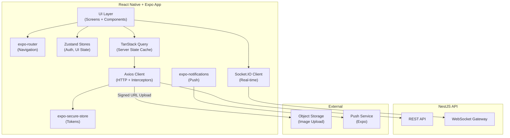

# 📱 TradeLink — Mobile App MVP Plan

> Detailed development plan for the TradeLink React Native + Expo mobile application. **We build mobile first.**

---

## Table of Contents

1. [Architecture Overview](#1-architecture-overview)
2. [Screen Map & Navigation](#2-screen-map--navigation)
3. [Component Library](#3-component-library)
4. [API Integration Layer](#4-api-integration-layer)
5. [Real-time Integration](#5-real-time-integration)
6. [Image Handling](#6-image-handling)
7. [Push Notifications](#7-push-notifications)
8. [Mobile Security](#8-mobile-security)
9. [Sprint-by-Sprint Development Plan](#9-sprint-by-sprint-development-plan)
10. [Testing Strategy](#10-testing-strategy)
11. [Build & Distribution](#11-build--distribution)
12. [Performance Targets](#12-performance-targets)

---

## 1. Architecture Overview

### Tech Stack

| Layer | Technology | Version |
|-------|-----------|---------|
| Framework | React Native + Expo | SDK 52+ |
| Language | TypeScript | 5.x (strict mode) |
| Routing | expo-router | v4 |
| Client State | Zustand | 5.x |
| Server State | TanStack Query (React Query) | v5 |
| Styling | NativeWind | v4 (Tailwind CSS for RN) |
| HTTP Client | Axios | 1.x |
| Secure Storage | expo-secure-store | — |
| Push | expo-notifications | — |
| Images | expo-image + expo-image-picker | — |
| Real-time | socket.io-client | 4.x |
| Forms | React Hook Form + Zod | — |

### Architecture Diagram



### Key Architectural Decisions

| Decision | Choice | Rationale |
|----------|--------|-----------|
| State management | Zustand (client) + TanStack Query (server) | Separation of concerns; TanStack handles caching, refetching, pagination |
| Navigation | expo-router (file-based) | Convention over configuration; deep linking built-in |
| Styling | NativeWind v4 | Familiar Tailwind syntax; design token integration; fast iteration |
| Forms | React Hook Form + Zod | Performance (uncontrolled inputs); schema-based validation shared with backend |
| Token storage | expo-secure-store | Hardware-backed encryption on iOS Keychain / Android Keystore |

---

## 2. Screen Map & Navigation

### Navigation Structure

```
Root Navigator (Stack)
├── Auth Stack (unauthenticated)
│   ├── Welcome
│   ├── Login
│   ├── Register
│   ├── EmailVerificationPending
│   ├── ForgotPassword
│   ├── ResetPassword (deep link)
│   └── CampusVerificationPending
│
└── Main Tab Navigator (authenticated)
    ├── Tab 1: Home (Stack)
    │   ├── HomeFeed
    │   ├── SearchResults
    │   ├── ListingDetail
    │   └── SellerProfile
    │
    ├── Tab 2: Sell (Stack)
    │   ├── CreateListing (multi-step)
    │   ├── MyListings
    │   └── EditListing
    │
    ├── Tab 3: Messages (Stack)
    │   ├── ConversationList
    │   └── ChatScreen
    │
    ├── Tab 4: Favorites (Stack)
    │   └── FavoriteListings
    │
    └── Tab 5: Profile (Stack)
        ├── MyProfile
        ├── EditProfile
        ├── NotificationPreferences
        ├── ActiveSessions
        ├── PrivacyInfo
        └── About

Modals (overlay on any screen):
├── ReportBottomSheet
├── BlockUserAlert
├── ImageViewer (full-screen)
└── FilterBottomSheet
```

### Detailed Screen Specifications

#### Auth Stack

| Screen | Key UI Elements | Actions |
|--------|----------------|---------|
| **Welcome** | App logo + tagline, feature highlights carousel, "Login" button (primary), "Create Account" button (secondary) | Navigate to Login or Register |
| **Login** | Email input, password input (show/hide toggle), "Forgot password?" link, "Login" button, "Don't have an account?" link | Validate → POST /auth/login → store tokens → navigate to Main |
| **Register** | Full name, email, password, confirm password, campus dropdown, terms checkbox, "Create Account" button | Validate → POST /auth/register → navigate to EmailVerificationPending |
| **Email Verification Pending** | Envelope illustration, "Check your email" message, email address display, "Resend" button (60s cooldown timer), "Already verified? Login" link | Resend verification email; navigate to Login |
| **Forgot Password** | Email input, "Send Reset Link" button, "Back to Login" link | POST /auth/forgot-password → show success message |
| **Reset Password** | New password, confirm password, "Reset Password" button | Accessed via deep link with token; POST /auth/reset-password |
| **Campus Verification Pending** | Status indicator (pending/approved), "Your campus verification is being reviewed" message, support contact | Auto-refresh status; show when user is EMAIL_VERIFIED but not CAMPUS_VERIFIED |

#### Tab 1: Home / Browse

| Screen | Key UI Elements | Actions |
|--------|----------------|---------|
| **Home Feed** | Search bar (top), horizontal scrolling category chips, "Recent Listings" section header, vertical listing cards (image, title, price, condition badge, campus, time ago), pull-to-refresh, infinite scroll | Tap search → SearchResults; Tap category → filtered results; Tap listing → ListingDetail |
| **Search Results** | Active filter tags (dismissable), results count, 2-column listing grid, filter FAB → FilterBottomSheet, sort dropdown, empty state illustration | Filter, sort, paginate results; Tap listing → ListingDetail |
| **Listing Detail** | Image carousel with page dots + counter, title, price (large, bold), condition badge, category tag, divider, description text, seller card (avatar + name + rating + join date + "View Profile"), "Message Seller" button (primary, full-width), favorite heart icon (top-right), share icon, "⋯" menu (Report), campus + pickup preference info | Favorite toggle; Message seller → create conversation; Report; Share |
| **Seller Profile** | Avatar (large), display name, campus name, member since, average rating + review count, "Active Listings" section with listing cards | View seller's other listings |

#### Tab 2: Sell

| Screen | Key UI Elements | Actions |
|--------|----------------|---------|
| **Create Listing** | Multi-step form with progress indicator (4 steps) | — |
| ↳ Step 1: Photos | "Add Photos" grid (up to 8), camera/gallery picker, drag-to-reorder, delete button on each, first photo = thumbnail label | Select images; reorder; delete |
| ↳ Step 2: Details | Title input (60 char, counter), description textarea (1000 char, counter), category picker (bottom sheet with icons) | Fill required fields |
| ↳ Step 3: Pricing | Price input (₱ prefix, numeric keyboard), condition selector (5 radio-style cards with icons), pickup preference text input (optional) | Set price and condition |
| ↳ Step 4: Preview | Full listing preview exactly as buyers see it, "Edit" and "Publish" buttons | Review → Publish (POST /listings) |
| **My Listings** | Segmented control tabs: Active / Reserved / Sold / Archived, listing cards with status badges, swipe actions (edit, change status, archive) | Manage listing status; tap to edit |
| **Edit Listing** | Same form as Create, pre-filled with existing data | Save changes (PATCH /listings/:id) |

#### Tab 3: Messages

| Screen | Key UI Elements | Actions |
|--------|----------------|---------|
| **Conversation List** | Search bar, conversations sorted by most recent activity, each row: other user's avatar, display name, listing thumbnail (small), last message preview (truncated), timestamp (relative), unread count badge (blue circle) | Tap → ChatScreen |
| **Chat Screen** | Header: back button, user name, listing reference card (thumbnail + title + price, tappable), message list (sent = right/blue bubbles, received = left/gray bubbles), timestamps (grouped by date), text input bar with send button, auto-scroll to bottom | Send message; tap listing reference → ListingDetail |

#### Tab 4: Favorites

| Screen | Key UI Elements | Actions |
|--------|----------------|---------|
| **Favorite Listings** | 2-column grid of favorited listings, heart icon to unfavorite, empty state ("No saved listings yet" + "Browse Marketplace" button) | Unfavorite (optimistic); Tap → ListingDetail |

#### Tab 5: Profile

| Screen | Key UI Elements | Actions |
|--------|----------------|---------|
| **My Profile** | Avatar with camera overlay for editing, display name, campus, verification badge(s), "Member since" date, rating/reviews count, divider, Settings list (Notification Preferences, Active Sessions, Privacy Information, Help & Support, About TradeLink), Account section (Request Deletion, Logout in red) | Navigate to sub-screens; Logout |
| **Edit Profile** | Avatar picker (camera/gallery), display name input, campus (read-only after verification) | Save (PATCH /users/me) |
| **Notification Preferences** | Toggle switches: Messages, Listing Updates, Moderation Actions | Save preferences to backend |
| **Active Sessions** | List of sessions (device, IP, last active), "Revoke" button on each, "Revoke All Other Sessions" button | Revoke sessions |

---

## 3. Component Library

### Design Token Integration

All components consume tokens from `packages/design-tokens`:

```typescript
// Import brand tokens
import { colors, spacing, fontSize, borderRadius } from '@TradeLink/design-tokens';
```

NativeWind `tailwind.config.js` extends with these tokens for `className` usage.

### Base Components

| Component | Variants / Props | Description |
|-----------|-----------------|-------------|
| `Button` | variant: `primary` / `secondary` / `outline` / `ghost` / `danger`; size: `sm` / `md` / `lg`; `loading`, `disabled` | Standard pressable button with haptic feedback |
| `TextInput` | `label`, `placeholder`, `error`, `secureTextEntry` toggle, `maxLength` counter, `leftIcon`, `rightIcon` | Form input with floating label and error state |
| `Card` | `variant`: `elevated` / `outlined` / `flat`; `padding`: `sm` / `md` / `lg` | Container with configurable shadow and border radius |
| `Avatar` | size: `xs(24)` / `sm(32)` / `md(40)` / `lg(56)` / `xl(72)`; `fallbackInitials`, `onlineIndicator` | Circular image with fallback initials |
| `Badge` | variant: `status` / `count` / `category`; color: brand colors | Small label for counts, statuses, categories |
| `BottomSheet` | `snapPoints`, `backdrop`, `handle`, `dismissible` | Modal from bottom with gesture handling |
| `Chip` | `selected`, `removable`, `icon`, `label` | Toggleable filter/tag chip |
| `Divider` | `spacing`, `color` | Horizontal separator line |
| `EmptyState` | `illustration`, `title`, `description`, `actionButton` | Full-area empty state placeholder |
| `ErrorState` | `message`, `onRetry` | Error display with retry button |
| `LoadingState` | variant: `skeleton` / `spinner` / `dots` | Loading placeholders |
| `Toast` | variant: `success` / `error` / `info` / `warning` | Auto-dismiss notification toast |
| `IconButton` | `icon`, `size`, `variant`, `onPress` | Circular icon-only pressable |

### Listing Components

| Component | Description |
|-----------|-------------|
| `ListingCard` | Image + title + price + condition badge + campus + time + favorite toggle; tap navigates to detail |
| `ListingGrid` | 2-column FlatList of ListingCards with responsive sizing |
| `ImageCarousel` | Horizontal FlatList with page indicator dots and "1/8" counter |
| `PriceTag` | Formatted PHP price: "₱ 350.00" with appropriate font size |
| `ConditionBadge` | Color-coded badge: New (green), Like New (teal), Good (blue), Fair (gold), Poor (gray) |
| `StatusBadge` | Listing status indicator: Draft (gray), Published (green), Reserved (gold), Sold (navy) |

### Chat Components

| Component | Description |
|-----------|-------------|
| `MessageBubble` | Sent (right, blue bg, white text) / Received (left, gray bg, dark text); timestamp; read indicator (✓✓) |
| `ConversationItem` | Avatar + name + listing thumb + last message + time + unread badge; pressable row |
| `ChatInput` | TextInput + Send button (disabled when empty); multiline support |
| `ListingReferenceCard` | Compact: thumbnail + title + price; shown at top of chat; tappable |

### Form Components

| Component | Description |
|-----------|-------------|
| `CategoryPicker` | BottomSheet with icon grid of categories; single-select |
| `PriceInput` | "₱" prefix + numeric TextInput with comma formatting |
| `ConditionSelector` | 5 radio-style cards (New → Poor) with icons and descriptions |
| `ImageUploader` | Grid of image slots (8 max) + "Add" button; drag-to-reorder; delete per image |
| `SearchBar` | Search icon + TextInput + clear button + optional cancel text |

---

## 4. API Integration Layer

### Axios Client Setup

```typescript
// services/api.ts
import axios from 'axios';
import * as SecureStore from 'expo-secure-store';

const api = axios.create({
  baseURL: process.env.EXPO_PUBLIC_API_URL,
  timeout: 30000,
  headers: { 'Content-Type': 'application/json' },
});

// Request interceptor: attach access token
api.interceptors.request.use(async (config) => {
  const token = await SecureStore.getItemAsync('accessToken');
  if (token) config.headers.Authorization = `Bearer ${token}`;
  return config;
});

// Response interceptor: handle 401 → refresh → retry
api.interceptors.response.use(
  (response) => response,
  async (error) => {
    const originalRequest = error.config;
    if (error.response?.status === 401 && !originalRequest._retry) {
      originalRequest._retry = true;
      try {
        const refreshToken = await SecureStore.getItemAsync('refreshToken');
        const { data } = await axios.post(`${baseURL}/auth/refresh`, { refreshToken });
        await SecureStore.setItemAsync('accessToken', data.accessToken);
        await SecureStore.setItemAsync('refreshToken', data.refreshToken);
        originalRequest.headers.Authorization = `Bearer ${data.accessToken}`;
        return api(originalRequest);
      } catch {
        // Refresh failed → logout
        await SecureStore.deleteItemAsync('accessToken');
        await SecureStore.deleteItemAsync('refreshToken');
        // Navigate to login
      }
    }
    return Promise.reject(error);
  }
);
```

### TanStack Query Configuration

```typescript
const queryClient = new QueryClient({
  defaultOptions: {
    queries: {
      staleTime: 5 * 60 * 1000,     // 5 minutes
      gcTime: 30 * 60 * 1000,       // 30 minutes (formerly cacheTime)
      retry: 3,
      retryDelay: (attempt) => Math.min(1000 * 2 ** attempt, 30000),
      refetchOnWindowFocus: false,   // Mobile: refetch on app foreground instead
    },
    mutations: {
      retry: 0,
    },
  },
});
```

### Custom Hooks

| Hook | Key Methods | Query Config |
|------|------------|--------------|
| `useAuth()` | `login`, `register`, `logout`, `refreshToken`, `verifyEmail`, `forgotPassword`, `resetPassword` | Mutations; invalidate all queries on logout |
| `useUser()` | `useProfile()`, `useUpdateProfile()`, `usePublicProfile(id)` | staleTime: 10 min |
| `useListings()` | `useInfiniteListings(filters)`, `useListing(id)`, `useCreateListing()`, `useUpdateListing()`, `useUpdateStatus()`, `useDeleteListing()` | Infinite query with cursor; staleTime: 5 min |
| `useSearch()` | `useSearchListings(query, filters)` | Debounced (300ms); keepPreviousData: true |
| `useFavorites()` | `useFavoritesList()`, `useAddFavorite()`, `useRemoveFavorite()` | Optimistic updates on add/remove |
| `useConversations()` | `useConversationList()`, `useCreateConversation()` | staleTime: 1 min; refetch on socket event |
| `useMessages()` | `useInfiniteMessages(conversationId)`, `useSendMessage()` | Infinite (reverse chronological); optimistic send |
| `useCategories()` | `useCategoryList()` | staleTime: 1 hour (rarely changes) |
| `useReports()` | `useCreateReport()` | Mutation only |

### Error Handling

```typescript
// Global error boundary for unhandled errors
<ErrorBoundary fallback={<ErrorScreen />}>
  <QueryClientProvider client={queryClient}>
    <App />
  </QueryClientProvider>
</ErrorBoundary>

// Per-query error states in screens
const { data, isLoading, isError, error, refetch } = useListings();

if (isLoading) return <ListingSkeleton />;
if (isError) return <ErrorState message={error.message} onRetry={refetch} />;

// Mutation error → Toast
const { mutate } = useCreateListing({
  onError: (error) => Toast.show({ type: 'error', text1: error.message }),
  onSuccess: () => {
    Toast.show({ type: 'success', text1: 'Listing published!' });
    navigation.navigate('MyListings');
  },
});
```

---

## 5. Real-time Integration

### Socket.IO Client Setup

```typescript
// services/socket.ts
import { io, Socket } from 'socket.io-client';
import * as SecureStore from 'expo-secure-store';

let socket: Socket | null = null;

export async function connectSocket() {
  const token = await SecureStore.getItemAsync('accessToken');
  if (!token) return;

  socket = io(process.env.EXPO_PUBLIC_WS_URL, {
    auth: { token },
    transports: ['websocket'],
    reconnection: true,
    reconnectionDelay: 1000,
    reconnectionDelayMax: 30000,
    reconnectionAttempts: Infinity,
  });

  socket.on('connect', () => console.log('Socket connected'));
  socket.on('disconnect', () => console.log('Socket disconnected'));
  socket.on('auth_error', () => { /* Handle → logout or refresh */ });
}
```

### Event Handling with TanStack Query

```typescript
// When receiving new message via socket → update cache
socket.on('new_message', (data: WsNewMessage) => {
  // Add message to conversation's message list cache
  queryClient.setQueryData(
    ['messages', data.conversationId],
    (old) => addMessageToCache(old, data.message)
  );
  // Update conversation list (last message, unread count)
  queryClient.invalidateQueries({ queryKey: ['conversations'] });
});

socket.on('listing_status_changed', (data: WsListingStatusChanged) => {
  queryClient.invalidateQueries({ queryKey: ['listing', data.listingId] });
  queryClient.invalidateQueries({ queryKey: ['listings'] });
});
```

### App Lifecycle

| App State | Socket Action |
|-----------|--------------|
| **Foreground** | Connect socket; listen for events |
| **Background** | Disconnect socket; rely on push notifications |
| **Killed** | No socket; rely on push notifications |
| **Return to foreground** | Reconnect socket; refetch stale queries |

---

## 6. Image Handling

### Upload Pipeline

```
User taps "Add Photo"
  → expo-image-picker (camera or gallery selection)
  → Validate: is image? is within size limit?
  → Compress with expo-image-manipulator:
      - Resize: max 1920px wide (maintain aspect ratio)
      - Compress: JPEG 80% quality
  → Display in ImageUploader grid with local URI
  → On "Publish" listing:
      For each image:
        1. POST /media/upload-url → get signed S3 URL + key
        2. PUT to signed URL (direct S3 upload) with progress tracking
        3. POST /media/confirm { key } → confirm upload
      Collect all keys → POST /listings { ..., imageKeys }
```

### Image Display

```typescript
// Using expo-image for optimized display
import { Image } from 'expo-image';

<Image
  source={{ uri: imageUrl }}
  placeholder={{ blurhash: listing.blurhash }}
  contentFit="cover"
  transition={200}
  cachePolicy="memory-disk"
  style={{ width: '100%', aspectRatio: 1 }}
/>
```

---

## 7. Push Notifications

### Setup Flow

1. After successful login + campus verification, request notification permission
2. On permission granted, get Expo push token
3. Register token with backend: `POST /users/me/push-token { token, platform }`
4. Backend stores token; uses it for push delivery when user is offline

### Notification Categories

| Category | Trigger | Deep Link Target |
|----------|---------|-----------------|
| `new_message` | New message in conversation | ChatScreen for that conversation |
| `listing_update` | Listing status changed (reserved, sold) | ListingDetail |
| `moderation_action` | Account warning, listing removed | MyProfile or relevant listing |
| `verification_update` | Campus verification approved | MyProfile |

### Deep Linking

```typescript
// Handle notification tap → navigate to relevant screen
Notifications.addNotificationResponseReceivedListener((response) => {
  const { type, targetId } = response.notification.request.content.data;
  
  switch (type) {
    case 'new_message':
      router.push(`/messages/${targetId}`);
      break;
    case 'listing_update':
      router.push(`/listings/${targetId}`);
      break;
    // ...
  }
});
```

---

## 8. Mobile Security

| Measure | Implementation | Priority |
|---------|---------------|----------|
| **Token storage** | expo-secure-store (iOS Keychain / Android Keystore) | 🔴 Must have |
| **No sensitive data in AsyncStorage** | Only store non-sensitive preferences in AsyncStorage | 🔴 Must have |
| **HTTPS only** | Axios baseURL uses `https://`; ATS enforced on iOS | 🔴 Must have |
| **Certificate pinning** | expo-certificate-transparency or custom plugin | 🟡 Consideration for production |
| **Jailbreak/root detection** | expo-device checks; warn user if detected | 🟡 Consideration |
| **Screen capture prevention** | Prevent screenshots on sensitive screens (OTP, sessions) | 🟢 Nice to have |
| **Biometric auth** | expo-local-authentication for returning users | 🟢 Future phase |
| **Code obfuscation** | Hermes engine (default in Expo) provides bytecode compilation | ✅ Built-in |

---

## 9. Sprint-by-Sprint Development Plan

### Sprint 1-2: Foundation & Setup (Weeks 1-2)

**Goal**: Project setup, navigation skeleton, base components, auth UI (no backend yet).

| Deliverable | Details |
|-------------|---------|
| Expo project init | TypeScript strict, SDK 52+, expo-router v4 |
| NativeWind setup | Tailwind config with design tokens from `@TradeLink/design-tokens` |
| Navigation structure | All stacks and tabs defined with placeholder screens |
| Base components | Button, TextInput, Card, Avatar, Badge, EmptyState, LoadingState, Toast, Divider, IconButton |
| Auth screen UI | Welcome, Login, Register, EmailVerificationPending, ForgotPassword screens — layout and validation only, no API |
| API client skeleton | Axios instance with interceptor structure, TanStack Query provider |
| Zustand stores | Auth store (token state, user profile, login/logout actions) |
| Dev tooling | ESLint, Prettier, path aliases, environment config |

**Exit criteria**: App runs on simulator; can navigate through all auth screens with form validation; components render correctly.

### Sprint 3-4: Authentication (Weeks 3-4)

**Goal**: Full authentication flow connected to live API.

| Deliverable | Details |
|-------------|---------|
| Registration flow | Form validation → POST /auth/register → navigate to verification pending |
| Login flow | POST /auth/login → store tokens in expo-secure-store → navigate to main tabs |
| Token refresh | Axios interceptor handles 401 → refresh → retry seamlessly |
| Email verification | Deep link handling for verify-email token; resend button with cooldown |
| Forgot/reset password | Full flow with deep link for reset token |
| Campus verification | Pending state screen; auto-redirect on verification status change |
| Session persistence | Auto-login on app restart if valid refresh token exists |
| Logout | Clear tokens, reset stores, navigate to Welcome |
| Form validation | Zod schemas for all auth forms; inline error messages |

**Exit criteria**: User can register → verify email → login → auto-login on restart → logout. Token refresh works transparently.

### Sprint 5-6: Marketplace Browsing (Weeks 5-6)

**Goal**: Users can browse, search, and view listings.

| Deliverable | Details |
|-------------|---------|
| Home feed | API-connected listing feed with ListingCard components |
| Categories | Horizontal chips; tap to filter listings by category |
| Search | Search bar with debounced API query (300ms); search results screen |
| Filters | FilterBottomSheet: category, price range, condition, sort order |
| Listing detail | Full screen: image carousel, all details, seller card |
| Seller profile | Public profile with their active listings |
| Pagination | Cursor-based infinite scroll on listing feeds |
| Pull-to-refresh | On all feed screens |
| Loading states | Skeleton screens for listing cards and detail |
| Empty states | "No listings found" with illustration and "Clear filters" action |
| Error states | "Something went wrong" with retry button |

**Exit criteria**: User can browse home feed, search, apply filters, view listing details, and see seller profiles. All loading/empty/error states handled.

### Sprint 7-8: Listings & Image Upload (Weeks 7-8)

**Goal**: Sellers can create, edit, and manage their listings with photos.

| Deliverable | Details |
|-------------|---------|
| Create listing form | 4-step multi-step form with progress indicator |
| Image picker | Camera + gallery selection via expo-image-picker |
| Image compression | Resize + compress before upload |
| Signed URL upload | Get signed URL → upload to S3 → confirm with API; progress bar |
| Multi-image management | Add up to 8 images; reorder (drag); delete; first = thumbnail |
| Listing validation | Required fields, price format, description length |
| My Listings screen | Tab bar: Active / Reserved / Sold / Archived |
| Edit listing | Pre-filled form; save changes |
| Status changes | Mark reserved, mark sold, archive — with confirmation dialogs |
| Delete listing | Soft-delete with confirmation |

**Exit criteria**: User can create a listing with photos, see it on the home feed, edit it, change its status, and manage all their listings.

### Sprint 9-10: Messaging & Notifications (Weeks 9-10)

**Goal**: Buyers and sellers can communicate in real-time.

| Deliverable | Details |
|-------------|---------|
| Conversation list | Sorted by recent; unread badges; listing thumbnail reference |
| "Message Seller" button | On listing detail → create conversation → navigate to chat |
| Chat screen | Real-time messages with MessageBubble components |
| Socket.IO integration | Connect on foreground; events: new_message, typing |
| Message persistence | Messages sent via REST API; real-time delivery via socket |
| Push notifications | expo-notifications setup; permission request; token registration |
| Notification deep links | Tap notification → navigate to relevant screen |
| Notification preferences | Toggle switches for message, listing, moderation notifications |
| Typing indicator | "User is typing..." indicator in chat |

**Exit criteria**: Two users can have a real-time conversation from a listing. Push notifications work when app is backgrounded. Typing indicators visible.

### Sprint 11-12: Favorites, Trust, Safety & Polish (Weeks 11-12)

**Goal**: Complete remaining features; polish, test, and prepare for pilot.

| Deliverable | Details |
|-------------|---------|
| Favorites | Add/remove with heart icon (optimistic update); Favorites tab with grid |
| Report flow | BottomSheet: select target type, reason, optional details; submit |
| Block user | Confirmation dialog; blocked user cannot message; server enforced |
| Edit profile | Update display name, profile photo |
| Active sessions | View and revoke sessions |
| Privacy information | Static privacy notice screen |
| Account deletion | Request deletion flow with confirmation |
| Error handling polish | Comprehensive error boundaries; network error handling; retry logic |
| Performance optimization | React.memo on list items; FlatList optimization; image caching |
| Accessibility | Accessible labels on all interactive elements; contrast check; touch target sizes (≥44px) |
| E2E testing | Maestro test flows for critical paths |
| Bug fixes | Address all known issues from internal testing |

**Exit criteria**: All features complete and polished. No critical bugs. E2E tests pass. App ready for internal distribution and stakeholder review.

### Sprint Summary Timeline

```
Week  1-2:  ████████ Foundation & Setup
Week  3-4:  ████████ Authentication
Week  5-6:  ████████ Marketplace Browsing
Week  7-8:  ████████ Listings & Image Upload
Week  9-10: ████████ Messaging & Notifications
Week 11-12: ████████ Favorites, Trust & Polish
            ────────────────────────────────
            Total: ~12 weeks (3 months)
```

---

## 10. Testing Strategy

| Level | Tool | Coverage Target | What to Test |
|-------|------|----------------|--------------|
| **Unit** | Jest | 80% on business logic | Utility functions, Zustand stores, form validation schemas, data transformers |
| **Component** | @testing-library/react-native | All base + listing + chat components | Rendering, props, user interactions, states (loading/error/empty) |
| **Hook** | @testing-library/react-hooks + MSW | All custom hooks | API calls, cache behavior, error handling, optimistic updates |
| **Integration** | MSW (Mock Service Worker) | Critical flows | Auth flow, listing CRUD, messaging flow |
| **E2E** | Maestro | Critical user journeys | Register → Login → Browse → Create Listing → Message → Favorite |
| **Manual** | Physical devices | Full app | Device matrix testing, network conditions, edge cases |

### Device Testing Matrix

| Platform | Devices | OS Versions |
|----------|---------|-------------|
| Android | Pixel 7 (or equivalent mid-range), Samsung Galaxy S23 | Android 13, 14 |
| iOS | iPhone 14, iPhone 15 | iOS 17, 18 |

---

## 11. Build & Distribution

### EAS Build Profiles

| Profile | Purpose | Distribution |
|---------|---------|-------------|
| `development` | Development builds with dev client | Internal (developer devices) |
| `preview` | Staging builds for stakeholder review | Internal (EAS internal distribution) |
| `production` | Release builds for app stores | Google Play / App Store |

### Release Pipeline

```
Feature branch
  → Pull Request (lint + type-check + unit tests)
  → Merge to main
  → EAS Build (development profile)
  → Manual QA on development build
  → EAS Build (preview profile)
  → Stakeholder review on preview build
  → EAS Build (production profile)
  → Google Play Internal Testing / TestFlight
  → Production release
```

### OTA Updates (EAS Update)

For non-native changes (JS/TS code, assets), use EAS Update for instant OTA delivery without app store review.

---

## 12. Performance Targets

| Metric | Target | Measurement |
|--------|--------|-------------|
| Cold start | < 3 seconds (mid-range Android) | Measured on Pixel 7 equivalent |
| Warm start | < 1.5 seconds | Time to interactive |
| Screen transitions | < 300ms | Navigation animation complete |
| Listing feed scroll | 60 fps | No dropped frames during scroll |
| Image load | Progressive with blur placeholder | expo-image blurhash |
| Message delivery | < 500ms perceived | Send → visible in recipient's chat |
| Search results | < 1 second | Query to results rendered |
| App bundle size | < 25 MB initial download | EAS build output |
| Memory usage | < 200 MB typical | Profiled during active use |

### Optimization Techniques

- `React.memo` on `ListingCard`, `MessageBubble`, `ConversationItem`
- `FlatList` with `getItemLayout`, `maxToRenderPerBatch`, `windowSize` tuning
- expo-image with `cachePolicy="memory-disk"` for all listing images
- Lazy loading for non-visible tab screens
- Hermes engine for faster startup and lower memory
- Bundle analysis with `npx expo export` to identify large dependencies

---

> **Document version**: 1.0
> **Last updated**: November 2026
> **Status**: Ready for Sprint 1 kickoff
