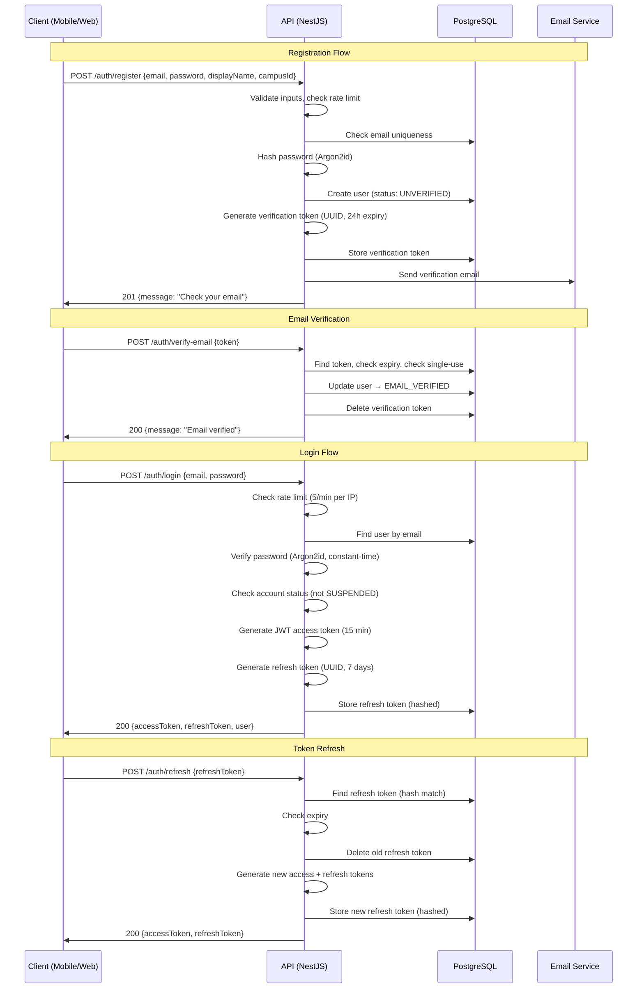

# 🔒 TradeLink — Security & Authentication Plan

> Comprehensive security architecture, authentication design, and attack prevention strategy for the TradeLink marketplace.

---

## Table of Contents

1. [Authentication Architecture](#1-authentication-architecture)
2. [Authorization & Access Control](#2-authorization--access-control)
3. [API Security](#3-api-security)
4. [Attack Prevention Matrix](#4-attack-prevention-matrix)
5. [Data Protection & Privacy](#5-data-protection--privacy)
6. [File Upload Security](#6-file-upload-security)
7. [Real-time / WebSocket Security](#7-real-time--websocket-security)
8. [Admin & Moderation Security](#8-admin--moderation-security)
9. [Secrets Management](#9-secrets-management)
10. [Security Monitoring & Incident Response](#10-security-monitoring--incident-response)
11. [Pre-Launch Security Checklist](#11-pre-launch-security-checklist)

---

## 1. Authentication Architecture

### 1.1 Password Hashing

All passwords are hashed using **Argon2id** with the following parameters:

| Parameter | Value | Rationale |
|-----------|-------|-----------|
| Memory cost | 65536 KB (64 MB) | Resists GPU-based attacks |
| Time cost (iterations) | 3 | Balance between security and UX |
| Parallelism | 4 | Matches typical server core count |
| Hash length | 32 bytes | Sufficient entropy |
| Salt | 16 bytes random | Unique per user |

```typescript
// auth.service.ts
import * as argon2 from 'argon2';

async hashPassword(password: string): Promise<string> {
  return argon2.hash(password, {
    type: argon2.argon2id,
    memoryCost: 65536,
    timeCost: 3,
    parallelism: 4,
    hashLength: 32,
  });
}

async verifyPassword(hash: string, password: string): Promise<boolean> {
  return argon2.verify(hash, password);
}
```

### 1.2 Token Strategy

| Token | Type | Lifetime | Storage (Mobile) | Storage (Web) |
|-------|------|----------|-------------------|---------------|
| Access Token | JWT | 15 minutes | expo-secure-store | Memory (JS variable) |
| Refresh Token | Opaque (UUID) | 7 days | expo-secure-store | httpOnly, Secure, SameSite=Strict cookie |

**Token rotation**: Every refresh request issues a new refresh token and invalidates the previous one. This limits the window of a stolen refresh token.

**Revocation triggers**:
- Logout → revoke current refresh token
- Password change → revoke ALL refresh tokens for user
- Account suspension → revoke ALL refresh tokens for user
- Admin force-logout → revoke ALL refresh tokens for user

### 1.3 JWT Access Token Payload

```json
{
  "sub": "user-uuid",
  "email": "student@uc.edu.ph",
  "role": "STUDENT",
  "verificationStatus": "CAMPUS_VERIFIED",
  "accountStatus": "ACTIVE",
  "iat": 1700000000,
  "exp": 1700000900
}
```

> [!CAUTION]
> Never include password hashes, internal database IDs, or sensitive PII in the JWT payload. The JWT is decodable by anyone.

### 1.4 Authentication Flow



### 1.5 Email Verification

| Property | Value |
|----------|-------|
| Token format | UUID v4 |
| Expiry | 24 hours |
| Single-use | Yes — deleted after use |
| Resend cooldown | 60 seconds |
| Max resends | 5 per 24 hours |

### 1.6 Password Reset

| Property | Value |
|----------|-------|
| Token format | Cryptographically random, 64 bytes, hex-encoded |
| Expiry | 1 hour |
| Single-use | Yes — deleted after use |
| Rate limit | 3 requests per hour per email |
| Response | Always "If the email exists, a reset link has been sent" (prevents enumeration) |
| Side effect | On successful reset, revoke ALL user sessions |

### 1.7 Campus Verification

| Method | Implementation |
|--------|---------------|
| **Auto-verify (preferred)** | Email domain `@uc.edu.ph` → automatically set to `CAMPUS_VERIFIED` after email verification |
| **Manual verification** | Non-UC emails → admin reviews and manually approves via admin console |

Only `CAMPUS_VERIFIED` users can: create listings, start conversations, save favorites.

### 1.8 Session Management

Each refresh token is stored with metadata:

```typescript
model RefreshToken {
  id        String   @id @default(uuid())
  userId    String
  user      User     @relation(fields: [userId], references: [id], onDelete: Cascade)
  tokenHash String   @unique
  deviceInfo String?
  ipAddress  String?
  lastUsedAt DateTime @default(now())
  expiresAt  DateTime
  createdAt  DateTime @default(now())
}
```

Users can view active sessions (device, IP, last used) and revoke individual sessions from their profile.

---

## 2. Authorization & Access Control

### 2.1 RBAC Permission Matrix

| Action | Guest | Student (Unverified) | Student (Verified) | Moderator | Admin |
|--------|-------|---------------------|-------------------|-----------|-------|
| View public listings | ✅ (limited) | ✅ | ✅ | ✅ | ✅ |
| Search/filter | ✅ (limited) | ✅ | ✅ | ✅ | ✅ |
| View listing detail | ✅ | ✅ | ✅ | ✅ | ✅ |
| Register | ✅ | — | — | — | — |
| Login | — | ✅ | ✅ | ✅ | ✅ |
| View own profile | — | ✅ | ✅ | ✅ | ✅ |
| Edit own profile | — | ✅ | ✅ | ✅ | ✅ |
| Create listing | — | ❌ | ✅ | ✅ | ✅ |
| Edit own listing | — | — | ✅ (owner) | ✅ (owner) | ✅ |
| Save favorites | — | ❌ | ✅ | ✅ | ✅ |
| Start conversation | — | ❌ | ✅ | ✅ | ✅ |
| Send messages | — | ❌ | ✅ (participant) | ✅ (participant) | ✅ |
| Report content | — | ❌ | ✅ | ✅ | ✅ |
| Block users | — | ❌ | ✅ | ✅ | ✅ |
| View moderation queue | — | — | — | ✅ | ✅ |
| Hide/remove listings | — | — | — | ✅ | ✅ |
| Warn users | — | — | — | ✅ | ✅ |
| Suspend/reactivate accounts | — | — | — | — | ✅ |
| Manage categories | — | — | — | — | ✅ |
| Manage platform config | — | — | — | — | ✅ |
| Assign moderator role | — | — | — | — | ✅ |
| View audit logs | — | — | — | — | ✅ |

### 2.2 NestJS Guard Implementation

```typescript
// roles.decorator.ts
import { SetMetadata } from '@nestjs/common';
import { UserRole } from '@prisma/client';

export const ROLES_KEY = 'roles';
export const Roles = (...roles: UserRole[]) => SetMetadata(ROLES_KEY, roles);

// roles.guard.ts
@Injectable()
export class RolesGuard implements CanActivate {
  constructor(private reflector: Reflector) {}

  canActivate(context: ExecutionContext): boolean {
    const requiredRoles = this.reflector.getAllAndOverride<UserRole[]>(
      ROLES_KEY,
      [context.getHandler(), context.getClass()],
    );
    if (!requiredRoles) return true;

    const { user } = context.switchToHttp().getRequest();
    return requiredRoles.includes(user.role);
  }
}

// verified.guard.ts — ensures campus verification
@Injectable()
export class VerifiedGuard implements CanActivate {
  canActivate(context: ExecutionContext): boolean {
    const { user } = context.switchToHttp().getRequest();
    if (user.verificationStatus !== 'CAMPUS_VERIFIED') {
      throw new ForbiddenException('Campus verification required');
    }
    return true;
  }
}

// Usage in controller
@Post()
@UseGuards(JwtAuthGuard, VerifiedGuard)
createListing(@CurrentUser() user, @Body() dto: CreateListingDto) { ... }

@Patch(':id/status')
@UseGuards(JwtAuthGuard, RolesGuard)
@Roles(UserRole.ADMIN)
suspendUser(@Param('id') id: string, @Body() dto: SuspendUserDto) { ... }
```

### 2.3 Resource-Level Ownership

Every resource access is verified server-side:

```typescript
// listings.service.ts
async updateListing(listingId: string, userId: string, dto: UpdateListingDto) {
  const listing = await this.prisma.listing.findUnique({ where: { id: listingId } });
  
  if (!listing) throw new NotFoundException('Listing not found');
  if (listing.sellerId !== userId) throw new ForbiddenException('Not the listing owner');
  if (listing.status === 'REMOVED') throw new ForbiddenException('Listing has been removed');
  
  return this.prisma.listing.update({ where: { id: listingId }, data: dto });
}
```

> [!IMPORTANT]
> **Never trust client-sent data** for: user role, seller ID, listing ownership, price calculations, moderation status, verification status. Always derive from the authenticated session and validate server-side.

---

## 3. API Security

### 3.1 Rate Limiting

| Endpoint Category | Limit | Window | Key |
|-------------------|-------|--------|-----|
| Registration | 3 requests | 1 minute | IP |
| Login | 5 requests | 1 minute | IP + email |
| Password reset | 3 requests | 1 hour | Email |
| Token refresh | 10 requests | 1 minute | User ID |
| Listing creation | 10 requests | 1 minute | User ID |
| Image upload | 20 requests | 1 minute | User ID |
| Messaging | 30 requests | 1 minute | User ID |
| Search | 60 requests | 1 minute | IP + User ID |
| Reports | 5 requests | 1 minute | User ID |
| General API | 100 requests | 1 minute | IP |

```typescript
// NestJS rate limiting with @nestjs/throttler
@Module({
  imports: [
    ThrottlerModule.forRoot([
      { name: 'short', ttl: 1000, limit: 3 },   // 3/sec
      { name: 'medium', ttl: 60000, limit: 100 }, // 100/min
    ]),
  ],
})

// Per-endpoint override
@Throttle({ short: { ttl: 60000, limit: 5 } })
@Post('login')
login(@Body() dto: LoginDto) { ... }
```

### 3.2 Input Validation

All inputs validated with `class-validator` + `class-transformer`:

```typescript
// register.dto.ts
export class RegisterDto {
  @IsEmail()
  @MaxLength(255)
  email: string;

  @IsString()
  @MinLength(8)
  @MaxLength(128)
  @Matches(/^(?=.*[a-z])(?=.*[A-Z])(?=.*\d)/, {
    message: 'Password must contain uppercase, lowercase, and number',
  })
  password: string;

  @IsString()
  @MinLength(2)
  @MaxLength(50)
  @Matches(/^[a-zA-Z\s\-'.]+$/)
  displayName: string;

  @IsUUID()
  campusId: string;
}
```

**Global validation pipe** (rejects unknown properties):

```typescript
app.useGlobalPipes(new ValidationPipe({
  whitelist: true,          // Strip unknown properties
  forbidNonWhitelisted: true, // Throw on unknown properties
  transform: true,          // Auto-transform types
  transformOptions: { enableImplicitConversion: true },
}));
```

### 3.3 Request Size Limits

| Limit | Value |
|-------|-------|
| JSON body | 1 MB |
| URL-encoded body | 1 MB |
| Upload per file | 5 MB |
| Total request | 10 MB |
| URL length | 2048 characters |

### 3.4 Security Headers (Helmet)

```typescript
import helmet from 'helmet';

app.use(helmet({
  contentSecurityPolicy: {
    directives: {
      defaultSrc: ["'self'"],
      scriptSrc: ["'self'"],
      styleSrc: ["'self'", "'unsafe-inline'"],
      imgSrc: ["'self'", "data:", "https://*.s3.amazonaws.com"],
      connectSrc: ["'self'", "wss:", "https:"],
      fontSrc: ["'self'"],
      objectSrc: ["'none'"],
      frameAncestors: ["'none'"],
    },
  },
  hsts: { maxAge: 31536000, includeSubDomains: true, preload: true },
  frameguard: { action: 'deny' },
  noSniff: true,
  referrerPolicy: { policy: 'strict-origin-when-cross-origin' },
}));
```

### 3.5 CORS Configuration

```typescript
app.enableCors({
  origin: [
    'https://TradeLink.app',
    'https://admin.TradeLink.app',
    process.env.NODE_ENV === 'development' && 'http://localhost:3000',
  ].filter(Boolean),
  methods: ['GET', 'POST', 'PATCH', 'PUT', 'DELETE'],
  credentials: true,
  maxAge: 86400,
});
```

---

## 4. Attack Prevention Matrix

| Attack | Risk | Prevention Measures | Implementation |
|--------|------|---------------------|----------------|
| **SQL Injection** | 🔴 Critical | Prisma parameterized queries; never use raw SQL without `$queryRaw` with parameter binding | Prisma ORM as only DB access layer |
| **XSS (Cross-Site Scripting)** | 🟠 High | Input sanitization on write; CSP headers; React auto-escaping; DOMPurify for any user-rendered HTML | Helmet CSP + class-validator + React |
| **CSRF** | 🟠 High | SameSite=Strict cookies; CSRF token on state-changing web requests; mobile uses Bearer tokens (immune) | csurf middleware for web; SameSite cookie flag |
| **IDOR (Broken Object-Level Auth)** | 🔴 Critical | Server-side ownership check on EVERY resource: listings, conversations, messages, profiles | Custom ownership guards in every service method |
| **Broken Authentication** | 🔴 Critical | Account lockout after 5 failed attempts (15 min); Argon2id hashing; session revocation; short-lived JWTs | Throttler + Argon2id + RefreshToken rotation |
| **Mass Assignment** | 🟠 High | DTOs with explicit whitelisted fields (`whitelist: true`); never spread `req.body` into queries | ValidationPipe with `forbidNonWhitelisted` |
| **File Upload Attacks** | 🟠 High | Magic byte MIME validation; image re-encoding via sharp; 5 MB limit; max 8 images; UUID storage keys; no executable content | Custom upload validation + sharp pipeline |
| **Brute Force** | 🟠 High | Progressive delays (1s, 2s, 4s, 8s, 16s); per-IP + per-email rate limiting; account lockout | Throttler + login attempt counter |
| **Man-in-the-Middle** | 🔴 Critical | HTTPS everywhere; HSTS with preload; certificate pinning on mobile (consideration) | Helmet HSTS + Expo SSL config |
| **DoS / DDoS** | 🟠 High | Rate limiting on all endpoints; pagination enforcement (max 50/page); request size limits; query timeout (30s) | Throttler + pagination guards |
| **Privilege Escalation** | 🔴 Critical | Server-side role enforcement at every endpoint; role changes only by ADMIN; audit log all role changes | RolesGuard + AuditLog |
| **User / Email Enumeration** | 🟡 Medium | Generic errors: "Invalid credentials" for all auth failures; constant-time password comparison | Argon2 verify (constant-time) + generic messages |
| **WebSocket Hijacking** | 🟠 High | JWT auth on WS handshake; per-event authorization; heartbeat timeout (30s); disconnect on token expiry | Socket.IO middleware auth |
| **Data Exposure** | 🟠 High | Minimal response payloads; never return passwordHash; `@Exclude()` decorator on sensitive fields; select specific fields in Prisma queries | class-transformer `@Exclude()` + Prisma `select` |
| **Injection via WebSocket** | 🟡 Medium | Validate and sanitize all WS event payloads; type-check message body; limit message length (2000 chars) | Socket event validation pipe |
| **Clickjacking** | 🟡 Medium | X-Frame-Options: DENY; CSP frame-ancestors: 'none' | Helmet frameguard |
| **Open Redirect** | 🟡 Medium | Whitelist all redirect URLs; validate redirect targets against known domains | Custom redirect validator |
| **Insecure Deserialization** | 🟡 Medium | Type-safe DTOs; no `eval()` or dynamic code execution; no raw JSON.parse of user input without validation | TypeScript strict mode + DTO validation |

---

## 5. Data Protection & Privacy

### 5.1 Philippine Data Privacy Act (RA 10173)

TradeLink handles personal information of Philippine nationals and must align with RA 10173:

| Requirement | Implementation |
|-------------|----------------|
| Lawful basis for processing | Consent at registration; contractual necessity for marketplace functionality |
| Data minimization | Collect only: email, display name, campus, optional profile photo |
| Purpose limitation | Personal data used only for marketplace functionality and safety |
| Transparency | Privacy notice published in-app and on web; accessible from profile |
| Data subject rights | Right to access, correct, erase, and port personal data |
| Security measures | Encryption at rest and in transit; access controls; audit logging |
| Breach notification | Procedure to notify NPC and affected users within 72 hours |

### 5.2 PII Inventory

| Data | Purpose | Retention | Deletion Method |
|------|---------|-----------|----------------|
| Email | Account identity, verification, communication | Account lifetime + 30 days | Hard delete |
| Display name | Marketplace identity | Account lifetime + 30 days | Anonymize to "Deleted User" |
| Password hash | Authentication | Account lifetime | Hard delete |
| Profile photo | Optional identity | Account lifetime | Delete from object storage |
| Campus ID | Community scoping | Account lifetime | Hard delete |
| IP address (login) | Security, abuse prevention | 90 days | Auto-purge |
| Device info (sessions) | Session management | Session lifetime | Delete on session revoke |
| Messages | Buyer-seller communication | 1 year after last activity | Soft delete, then purge |
| Listing content | Marketplace functionality | 6 months after sold/archived | Soft delete, then purge |

### 5.3 Encryption

| Layer | Method |
|-------|--------|
| **In transit** | TLS 1.2+ (prefer TLS 1.3); HSTS preload |
| **At rest (database)** | Managed PostgreSQL encryption (provider-specific); encrypted backups |
| **At rest (storage)** | S3 server-side encryption (SSE-S3 or SSE-KMS) |
| **Sensitive fields** | Password hashing (Argon2id); refresh token hashing (SHA-256) |
| **Backups** | Encrypted with separate backup key; stored in separate region |

### 5.4 Account Deletion

When a user requests account deletion:
1. Soft-delete: set `accountStatus = DEACTIVATED`, anonymize display name to "Deleted User"
2. Remove profile photo from object storage
3. Keep listing records (anonymized) for marketplace integrity
4. Keep messages for 30 days (counter-party may need them), then purge
5. Hard-delete after 30-day grace period (user can cancel during this window)
6. Log the deletion request and execution in audit log

---

## 6. File Upload Security

### 6.1 Allowed Formats

| Format | MIME Type | Magic Bytes |
|--------|-----------|-------------|
| JPEG | `image/jpeg` | `FF D8 FF` |
| PNG | `image/png` | `89 50 4E 47 0D 0A 1A 0A` |
| WebP | `image/webp` | `52 49 46 46 ... 57 45 42 50` |

> [!WARNING]
> **Never trust the file extension or client-sent Content-Type**. Always inspect the magic bytes of the file buffer.

### 6.2 Upload Limits

| Limit | Value |
|-------|-------|
| Max file size | 5 MB per image |
| Max images per listing | 8 |
| Max profile photo size | 2 MB |
| Allowed formats | JPEG, PNG, WebP only |
| Upload URL expiry | 5 minutes |
| Upload URL usage | Single-use |

### 6.3 Image Processing Pipeline

```
Client selects image
  → Client compresses (max 1920px, 80% quality)
  → Client requests signed upload URL from API
  → API validates: auth, file metadata, rate limit
  → API returns signed S3 PUT URL (5 min expiry)
  → Client uploads directly to S3
  → Client confirms upload with API
  → API validates: object exists, size within limits
  → API processes with sharp:
      1. Validate magic bytes
      2. Strip ALL EXIF/metadata
      3. Resize if > 1920px wide (maintain aspect ratio)
      4. Re-encode to JPEG/WebP (removes embedded exploits)
      5. Store processed image with randomized key
  → API stores media record in database
```

### 6.4 Storage Security

- **Private bucket**: no public access; all reads via signed download URLs (1 hour expiry)
- **Randomized keys**: `{userId}/{uuid}.{ext}` — unpredictable, prevents enumeration
- **Content-Disposition**: `attachment` header to prevent browser inline execution
- **Lifecycle rules**: auto-delete orphaned uploads after 24 hours
- **No executable content**: re-encoding eliminates embedded scripts

---

## 7. Real-time / WebSocket Security

### 7.1 Connection Authentication

```typescript
// conversations.gateway.ts
@WebSocketGateway({ cors: { origin: allowedOrigins } })
export class ConversationsGateway implements OnGatewayConnection {
  async handleConnection(client: Socket) {
    try {
      const token = client.handshake.auth?.token 
        || client.handshake.headers?.authorization?.split(' ')[1];
      
      if (!token) {
        client.emit('auth_error', { message: 'Token required' });
        client.disconnect();
        return;
      }

      const payload = this.jwtService.verify(token);
      const user = await this.usersService.findById(payload.sub);
      
      if (!user || user.accountStatus === 'SUSPENDED') {
        client.emit('auth_error', { message: 'Access denied' });
        client.disconnect();
        return;
      }

      client.data.userId = user.id;
      client.data.role = user.role;
      
      // Join user-specific room for notifications
      client.join(`user:${user.id}`);
    } catch (error) {
      client.emit('auth_error', { message: 'Invalid token' });
      client.disconnect();
    }
  }
}
```

### 7.2 Per-Event Authorization

Every socket event verifies:
1. User is still authenticated (token not expired)
2. User is a participant in the conversation
3. User is not blocked by the other participant
4. User account is not suspended
5. Message content is validated (length, content rules)

### 7.3 Rate Limiting

| Event | Limit |
|-------|-------|
| send_message | 1 message/second per user |
| typing indicator | 1 event/3 seconds per conversation |
| Connection attempts | 5/minute per IP |

### 7.4 Heartbeat & Disconnect

- **Ping interval**: 25 seconds
- **Ping timeout**: 5 seconds (disconnect after 2 missed pongs = 30s)
- **Token expiry**: auto-disconnect when JWT expires; client must reconnect with fresh token
- **Account suspension**: server forcefully disconnects all sockets for suspended user

---

## 8. Admin & Moderation Security

### 8.1 Admin Access Controls

| Control | Implementation |
|---------|----------------|
| Role enforcement | `@Roles(UserRole.ADMIN)` guard on all admin endpoints |
| Moderator scope | Moderators can review reports and hide content; cannot suspend accounts or manage config |
| Session timeout | Admin sessions expire after 30 minutes of inactivity |
| MFA consideration | TOTP-based MFA for admin accounts (Phase 3 or post-MVP) |
| IP restriction | Consideration: restrict admin panel access to known IPs in production |

### 8.2 Audit Trail

Every sensitive admin action is logged:

```typescript
interface AuditLogEntry {
  id: string;
  actorId: string;        // Admin/moderator who performed the action
  action: AuditAction;    // e.g., USER_SUSPENDED, LISTING_REMOVED, REPORT_RESOLVED
  targetType: string;     // 'User', 'Listing', 'Report'
  targetId: string;       // ID of the affected resource
  reason: string;         // Required reason (10-500 characters)
  metadata: object;       // Additional context (previous state, etc.)
  ipAddress: string;
  userAgent: string;
  createdAt: Date;
}
```

Audit logs are:
- **Append-only** — cannot be edited or deleted by any user
- **Searchable** by actor, action type, target, and date range
- **Retained** for minimum 2 years
- **Accessible** only to ADMIN role

### 8.3 Required Reason for Sensitive Actions

The following actions require a mandatory `reason` field (10-500 characters):

- Suspend user account
- Reactivate user account
- Remove listing
- Restore removed listing
- Resolve/dismiss report
- Change user role
- Modify platform configuration

---

## 9. Secrets Management

### 9.1 Environment Separation

| Environment | Secret Source | Access |
|-------------|-------------|--------|
| Local | `.env` file (git-ignored) | Developer only |
| Development | `.env` on dev server | Dev team |
| Staging | Managed secrets (SSM/Vault) | CI/CD + limited team |
| Production | Managed secrets (SSM/Vault) | CI/CD only; no human read access |

### 9.2 Secret Inventory

| Secret | Rotation Schedule | Notes |
|--------|-------------------|-------|
| `JWT_SECRET` | Every 90 days | Support dual-key validation during rotation |
| `DATABASE_URL` | On compromise | Use connection pooler with TLS |
| `S3_ACCESS_KEY` / `S3_SECRET_KEY` | Every 180 days | Use IAM roles where possible |
| `EMAIL_API_KEY` | Every 180 days | Scoped to send-only permission |
| `EXPO_ACCESS_TOKEN` | Every 180 days | Scoped to push notifications |

### 9.3 Rules

- ❌ Never commit `.env` files or secrets to git
- ❌ Never log secrets (even partially)
- ❌ Never include secrets in client bundles or mobile binaries
- ❌ Never hardcode secrets in source code
- ✅ Use `.env.example` with placeholder values
- ✅ Use managed secret services in production
- ✅ Rotate keys on schedule and immediately on suspected compromise
- ✅ Use separate credentials for every environment

---

## 10. Security Monitoring & Incident Response

### 10.1 Monitoring

| Signal | Alert Threshold | Action |
|--------|----------------|--------|
| Failed login attempts | 10 from same IP in 5 min | Auto-block IP for 30 min; alert team |
| Account lockouts | 5 lockouts in 1 hour | Alert team for review |
| Rate limit hits | Sustained rate limiting from single IP | Alert team; consider firewall rule |
| Error rate spike | > 5% of requests returning 5xx | Alert team; check deployment |
| Unusual listing creation | > 20 listings from one user in 1 hour | Flag for moderation review |
| Mass messaging | > 50 new conversations from one user in 1 hour | Auto-suspend; alert team |
| Admin actions | Any admin action | Log and notify admin channel |

### 10.2 Logging Rules

- ✅ Log: request method, path, status code, response time, user ID, IP, user agent
- ✅ Log: authentication events (login, logout, failed attempts, token refresh)
- ✅ Log: authorization failures (forbidden access attempts)
- ✅ Log: admin/moderation actions with full audit context
- ❌ Never log: passwords, tokens, full email addresses, personal data
- Use structured JSON logging format for machine parsing
- Ship logs to centralized logging service (e.g., CloudWatch, Datadog)

### 10.3 Incident Response Procedure

1. **Detect**: Automated alerts or user report
2. **Contain**: Isolate affected systems; suspend compromised accounts; revoke exposed tokens
3. **Eradicate**: Identify root cause; patch vulnerability; rotate compromised credentials
4. **Recover**: Restore from clean backup if needed; re-deploy patched code; verify fix
5. **Lessons Learned**: Document incident; update security controls; notify affected users (if data breach, within 72 hours per RA 10173)

---

## 11. Pre-Launch Security Checklist

### Authentication & Authorization
- [ ] All endpoints require authentication (except public listing browse and auth endpoints)
- [ ] Role-based access control enforced server-side on every endpoint
- [ ] Resource ownership verified server-side (listings, conversations, messages)
- [ ] Password hashing uses Argon2id with recommended parameters
- [ ] JWT access tokens expire in ≤ 15 minutes
- [ ] Refresh token rotation implemented (old token invalidated)
- [ ] Sessions revoked on password change and account suspension
- [ ] Account lockout after 5 failed login attempts

### Input & Output
- [ ] All user inputs validated with class-validator DTOs
- [ ] Unknown/extra properties rejected (`forbidNonWhitelisted`)
- [ ] Response payloads exclude sensitive fields (passwordHash, internal IDs)
- [ ] Error messages don't leak internal details to clients
- [ ] Request body size limits enforced

### API Security
- [ ] Rate limiting configured on all endpoints
- [ ] CORS allows only known origins
- [ ] Security headers configured (Helmet: CSP, HSTS, X-Frame-Options, etc.)
- [ ] HTTPS enforced; HSTS enabled with preload
- [ ] API versioning applied (/api/v1/)
- [ ] Pagination enforced on all list endpoints (max 50 per page)

### File Uploads
- [ ] Magic byte MIME validation (not just extension)
- [ ] Image re-encoding with EXIF stripping
- [ ] File size limits enforced (5 MB per image)
- [ ] Signed upload URLs with 5-minute expiry
- [ ] Private storage bucket; no direct public access
- [ ] Randomized storage keys (UUID-based)

### WebSocket
- [ ] Token authentication on connection handshake
- [ ] Per-event authorization checks
- [ ] Message rate limiting
- [ ] Auto-disconnect on token expiry or account suspension
- [ ] Payload validation on all events

### Data Protection
- [ ] Encryption in transit (TLS 1.2+)
- [ ] Encryption at rest (database, backups, object storage)
- [ ] PII minimized and retention periods defined
- [ ] Account deletion procedure implemented and tested
- [ ] Privacy notice published and accessible

### Infrastructure
- [ ] Secrets management reviewed (no secrets in code or git)
- [ ] Separate credentials per environment
- [ ] Database backups configured and restore tested
- [ ] Error monitoring and alerting active
- [ ] Dependency vulnerability scan clean (`npm audit`)
- [ ] Admin access restricted and audit-logged

### Testing
- [ ] OWASP Top 10 review completed
- [ ] SQL injection testing passed
- [ ] XSS testing passed
- [ ] Authorization bypass testing passed (users cannot access others' resources)
- [ ] Penetration test scheduled (pre-pilot)

---

> **Document version**: 1.0
> **Last updated**: November 2026
> **Next review**: Before Phase 4 pilot launch
