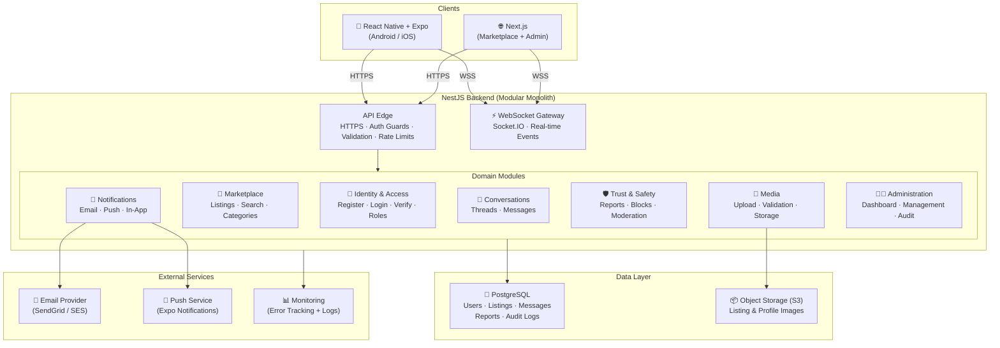
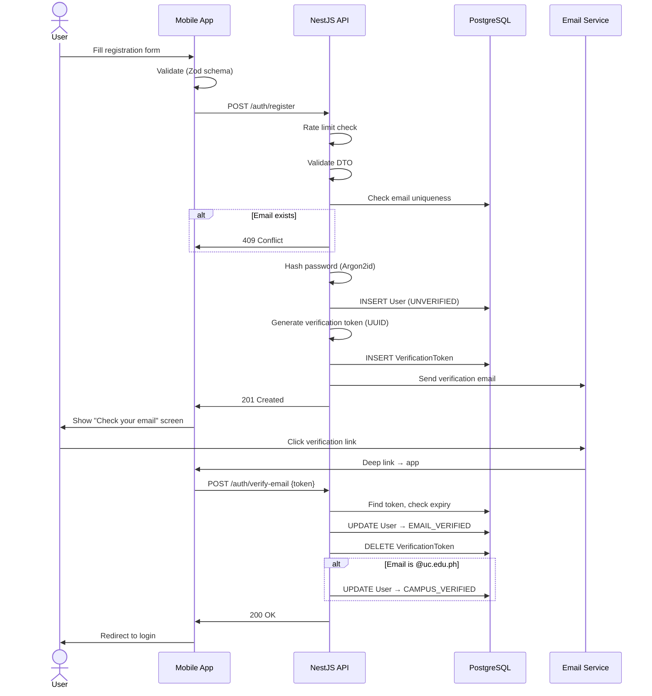
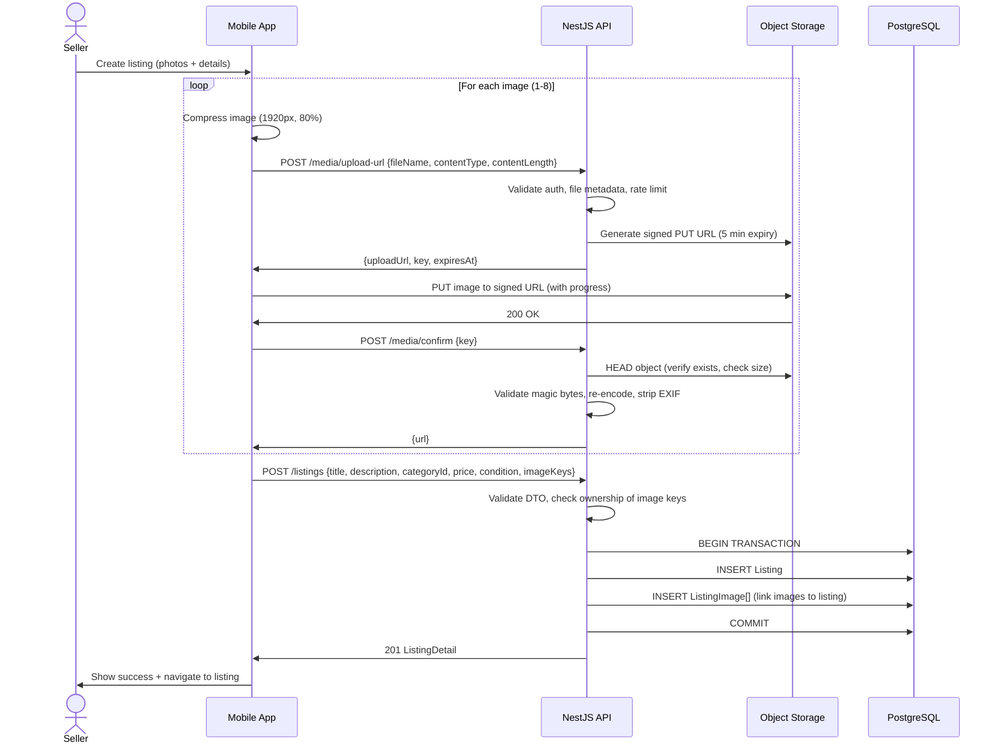
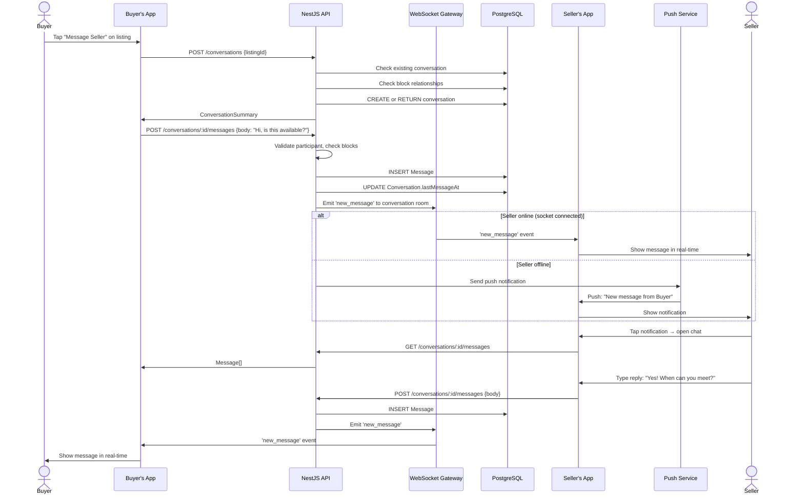

# 🏗️ TradeLink — System Design Document

> Complete system architecture, database schema, API specification, and implementation design for the TradeLink marketplace MVP.

---

## Table of Contents

1. [System Architecture Overview](#1-system-architecture-overview)
2. [Database Schema (Prisma)](#2-database-schema-prisma)
3. [API Specification](#3-api-specification)
4. [NestJS Module Architecture](#4-nestjs-module-architecture)
5. [Key Design Patterns](#5-key-design-patterns)
6. [Data Flow Diagrams](#6-data-flow-diagrams)
7. [Search Implementation](#7-search-implementation)
8. [Error Handling](#8-error-handling)
9. [Pagination](#9-pagination)
10. [Deployment Architecture](#10-deployment-architecture)

---

## 1. System Architecture Overview

### Architecture Style

**Modular monolith** — one NestJS backend deployment with clearly separated domain modules. Mobile and web clients consume the same REST API. WebSocket gateway handles real-time messaging within the same process. This keeps operations simple and costs low for the MVP while maintaining clear boundaries for future extraction.

### System Diagram



### Component Responsibilities

| Component | Responsibility |
|-----------|---------------|
| **React Native mobile app** | Student-facing Android/iOS experience; API calls, secure token storage, image upload, push notifications |
| **Next.js web app** | Responsive student marketplace and protected admin console |
| **NestJS API** | Authentication, authorization, business rules, listing/search, messaging, reports, moderation, notifications |
| **PostgreSQL** | Persistent relational records with transactional integrity |
| **Object Storage (S3)** | Listing and profile image files; API stores metadata and controlled file references |
| **WebSocket Gateway** | Authenticated real-time message delivery and conversation events |
| **External Services** | Email delivery (SendGrid/SES), push delivery (Expo), monitoring (Sentry/Datadog) |

### Request Flow

```
Client → HTTPS → Rate Limiter → Auth Guard → Validation Pipe
  → Controller → Service → Prisma → PostgreSQL
  → Response Interceptor → Client

Real-time: Client → WSS → Auth Middleware → Event Handler
  → Service → Prisma (persist) → Emit to recipients
```

---

## 2. Database Schema (Prisma)

```prisma
// prisma/schema.prisma

generator client {
  provider = "prisma-client-js"
}

datasource db {
  provider = "postgresql"
  url      = env("DATABASE_URL")
}

// ═══════════════════════════════════════
// ENUMS
// ═══════════════════════════════════════

enum UserRole {
  GUEST
  STUDENT
  MODERATOR
  ADMIN
}

enum AccountStatus {
  ACTIVE
  SUSPENDED
  DEACTIVATED
}

enum VerificationStatus {
  UNVERIFIED
  EMAIL_VERIFIED
  CAMPUS_VERIFIED
}

enum ListingStatus {
  DRAFT
  PENDING_REVIEW
  PUBLISHED
  RESERVED
  SOLD
  ARCHIVED
  REMOVED
}

enum ListingCondition {
  NEW
  LIKE_NEW
  GOOD
  FAIR
  POOR
}

enum ReportStatus {
  PENDING
  UNDER_REVIEW
  RESOLVED
  DISMISSED
}

enum ReportTargetType {
  LISTING
  USER
  CONVERSATION
}

enum NotificationType {
  NEW_MESSAGE
  LISTING_UPDATE
  REPORT_UPDATE
  ACCOUNT_UPDATE
  MODERATION_ACTION
}

enum AuditAction {
  USER_SUSPENDED
  USER_REACTIVATED
  USER_ROLE_CHANGED
  USER_VERIFIED
  LISTING_REMOVED
  LISTING_RESTORED
  REPORT_RESOLVED
  REPORT_DISMISSED
  CATEGORY_CREATED
  CATEGORY_UPDATED
  CONFIG_UPDATED
}

// ═══════════════════════════════════════
// MODELS
// ═══════════════════════════════════════

/// Campus / university branch entity
model Campus {
  id        String   @id @default(uuid())
  name      String   @unique              // e.g., "University of Cebu - Main"
  branch    String?                       // e.g., "Main", "Banilad", "LM"
  isActive  Boolean  @default(true)
  createdAt DateTime @default(now())
  updatedAt DateTime @updatedAt

  users    User[]
  listings Listing[]
}

/// Registered user account
model User {
  id                 String             @id @default(uuid())
  email              String             @unique
  passwordHash       String
  displayName        String
  profilePhoto       String?            // Object storage key
  campusId           String
  campus             Campus             @relation(fields: [campusId], references: [id])
  verificationStatus VerificationStatus @default(UNVERIFIED)
  role               UserRole           @default(STUDENT)
  accountStatus      AccountStatus      @default(ACTIVE)
  createdAt          DateTime           @default(now())
  updatedAt          DateTime           @updatedAt

  // Listings & marketplace
  listings            Listing[]
  favorites           Favorite[]

  // Conversations & messages
  buyerConversations  Conversation[]  @relation("buyer")
  sellerConversations Conversation[]  @relation("seller")
  sentMessages        Message[]       @relation("sender")

  // Trust & safety
  reportsSubmitted    Report[]        @relation("reporter")
  reportsAssigned     Report[]        @relation("assignee")
  blocksInitiated     Block[]         @relation("blocker")
  blocksReceived      Block[]         @relation("blocked")
  reviewsGiven        Review[]        @relation("reviewer")
  reviewsReceived     Review[]        @relation("reviewee")

  // System
  notifications       Notification[]
  auditLogsPerformed  AuditLog[]      @relation("actor")
  refreshTokens       RefreshToken[]
  pushTokens          PushToken[]

  @@index([email])
  @@index([campusId])
  @@index([role])
  @@index([accountStatus])
  @@index([verificationStatus])
}

/// Product listing in the marketplace
model Listing {
  id               String           @id @default(uuid())
  sellerId         String
  seller           User             @relation(fields: [sellerId], references: [id])
  categoryId       String
  category         Category         @relation(fields: [categoryId], references: [id])
  campusId         String
  campus           Campus           @relation(fields: [campusId], references: [id])
  title            String
  description      String
  price            Decimal          @db.Decimal(10, 2)
  condition        ListingCondition
  status           ListingStatus    @default(DRAFT)
  pickupPreference String?
  viewCount        Int              @default(0)
  searchVector     Unsupported("tsvector")?  // Full-text search vector
  createdAt        DateTime         @default(now())
  updatedAt        DateTime         @updatedAt

  images        ListingImage[]
  favorites     Favorite[]
  conversations Conversation[]
  reviews       Review[]

  @@index([sellerId])
  @@index([categoryId])
  @@index([campusId])
  @@index([status])
  @@index([price])
  @@index([createdAt])
  @@index([status, createdAt])
  @@index([status, categoryId, createdAt])
}

/// Image attached to a listing
model ListingImage {
  id           String  @id @default(uuid())
  listingId    String
  listing      Listing @relation(fields: [listingId], references: [id], onDelete: Cascade)
  storageKey   String  // Object storage key (e.g., "userId/uuid.jpg")
  displayOrder Int     @default(0)
  width        Int?
  height       Int?
  sizeBytes    Int?
  createdAt    DateTime @default(now())

  @@index([listingId])
  @@unique([listingId, displayOrder])
}

/// Marketplace category
model Category {
  id        String   @id @default(uuid())
  name      String   @unique       // e.g., "Books & Learning Materials"
  slug      String   @unique       // e.g., "books-learning-materials"
  icon      String?                // Icon identifier
  isActive  Boolean  @default(true)
  sortOrder Int      @default(0)
  createdAt DateTime @default(now())
  updatedAt DateTime @updatedAt

  listings Listing[]

  @@index([isActive, sortOrder])
}

/// User's saved/favorited listing
model Favorite {
  id        String   @id @default(uuid())
  userId    String
  user      User     @relation(fields: [userId], references: [id], onDelete: Cascade)
  listingId String
  listing   Listing  @relation(fields: [listingId], references: [id], onDelete: Cascade)
  createdAt DateTime @default(now())

  @@unique([userId, listingId])
  @@index([userId])
  @@index([listingId])
}

/// Buyer-seller conversation thread for a specific listing
model Conversation {
  id            String   @id @default(uuid())
  listingId     String
  listing       Listing  @relation(fields: [listingId], references: [id])
  buyerId       String
  buyer         User     @relation("buyer", fields: [buyerId], references: [id])
  sellerId      String
  seller        User     @relation("seller", fields: [sellerId], references: [id])
  lastMessageAt DateTime?
  createdAt     DateTime @default(now())
  updatedAt     DateTime @updatedAt

  messages Message[]

  @@unique([listingId, buyerId])  // One conversation per buyer per listing
  @@index([buyerId])
  @@index([sellerId])
  @@index([lastMessageAt])
}

/// Individual message within a conversation
model Message {
  id             String   @id @default(uuid())
  conversationId String
  conversation   Conversation @relation(fields: [conversationId], references: [id], onDelete: Cascade)
  senderId       String
  sender         User     @relation("sender", fields: [senderId], references: [id])
  body           String   // Message text content (max 2000 chars)
  readAt         DateTime?
  createdAt      DateTime @default(now())

  @@index([conversationId, createdAt])
  @@index([senderId])
}

/// User-submitted report on a listing, user, or conversation
model Report {
  id           String           @id @default(uuid())
  reporterId   String
  reporter     User             @relation("reporter", fields: [reporterId], references: [id])
  targetType   ReportTargetType
  targetId     String           // ID of the reported listing/user/conversation
  reason       String
  details      String?
  status       ReportStatus     @default(PENDING)
  assignedToId String?
  assignedTo   User?            @relation("assignee", fields: [assignedToId], references: [id])
  resolution   String?
  resolvedAt   DateTime?
  createdAt    DateTime         @default(now())
  updatedAt    DateTime         @updatedAt

  @@index([status])
  @@index([reporterId])
  @@index([targetType, targetId])
  @@index([assignedToId])
  @@index([status, createdAt])
}

/// User block relationship
model Block {
  id        String   @id @default(uuid())
  blockerId String
  blocker   User     @relation("blocker", fields: [blockerId], references: [id], onDelete: Cascade)
  blockedId String
  blocked   User     @relation("blocked", fields: [blockedId], references: [id], onDelete: Cascade)
  createdAt DateTime @default(now())

  @@unique([blockerId, blockedId])
  @@index([blockerId])
  @@index([blockedId])
}

/// Review/rating after a completed transaction
model Review {
  id          String  @id @default(uuid())
  reviewerId  String
  reviewer    User    @relation("reviewer", fields: [reviewerId], references: [id])
  revieweeId  String
  reviewee    User    @relation("reviewee", fields: [revieweeId], references: [id])
  listingId   String
  listing     Listing @relation(fields: [listingId], references: [id])
  rating      Int     // 1-5
  comment     String?
  createdAt   DateTime @default(now())

  @@unique([reviewerId, listingId])  // One review per reviewer per listing
  @@index([revieweeId])
  @@index([listingId])
}

/// In-app notification record
model Notification {
  id        String           @id @default(uuid())
  userId    String
  user      User             @relation(fields: [userId], references: [id], onDelete: Cascade)
  type      NotificationType
  title     String
  body      String
  data      Json?            // { targetType, targetId, etc. }
  readAt    DateTime?
  createdAt DateTime         @default(now())

  @@index([userId, readAt])
  @@index([userId, createdAt])
}

/// Admin/moderator audit trail
model AuditLog {
  id         String      @id @default(uuid())
  actorId    String
  actor      User        @relation("actor", fields: [actorId], references: [id])
  action     AuditAction
  targetType String      // "User", "Listing", "Report", "Category"
  targetId   String
  reason     String
  metadata   Json?       // Additional context (previous state, etc.)
  ipAddress  String?
  userAgent  String?
  createdAt  DateTime    @default(now())

  @@index([actorId])
  @@index([action])
  @@index([targetType, targetId])
  @@index([createdAt])
}

/// Refresh token for session management
model RefreshToken {
  id         String   @id @default(uuid())
  userId     String
  user       User     @relation(fields: [userId], references: [id], onDelete: Cascade)
  tokenHash  String   @unique  // SHA-256 hash of the actual token
  deviceInfo String?
  ipAddress  String?
  lastUsedAt DateTime @default(now())
  expiresAt  DateTime
  createdAt  DateTime @default(now())

  @@index([userId])
  @@index([expiresAt])
}

/// Push notification device token
model PushToken {
  id        String   @id @default(uuid())
  userId    String
  user      User     @relation(fields: [userId], references: [id], onDelete: Cascade)
  token     String   @unique  // Expo push token
  platform  String   // "ios" | "android"
  isActive  Boolean  @default(true)
  createdAt DateTime @default(now())
  updatedAt DateTime @updatedAt

  @@index([userId])
}

/// Email verification token
model VerificationToken {
  id        String   @id @default(uuid())
  email     String
  token     String   @unique
  expiresAt DateTime
  createdAt DateTime @default(now())

  @@index([email])
  @@index([token])
}

/// Password reset token
model PasswordResetToken {
  id        String   @id @default(uuid())
  email     String
  tokenHash String   @unique  // SHA-256 hash of the actual token
  expiresAt DateTime
  createdAt DateTime @default(now())

  @@index([email])
}
```

### Database Migrations

After schema changes:
```bash
npx prisma migrate dev --name <migration_name>  # Development
npx prisma migrate deploy                        # Production
```

### Full-Text Search Setup (SQL Migration)

```sql
-- Migration: add_listing_search_vector

-- Add tsvector column
ALTER TABLE "Listing" ADD COLUMN "searchVector" tsvector;

-- Populate existing rows
UPDATE "Listing" SET "searchVector" = 
  setweight(to_tsvector('english', coalesce("title", '')), 'A') ||
  setweight(to_tsvector('english', coalesce("description", '')), 'B');

-- Create GIN index for fast full-text search
CREATE INDEX "idx_listing_search_vector" ON "Listing" USING GIN ("searchVector");

-- Create trigger to auto-update on insert/update
CREATE OR REPLACE FUNCTION listing_search_vector_update() RETURNS trigger AS $$
BEGIN
  NEW."searchVector" :=
    setweight(to_tsvector('english', coalesce(NEW."title", '')), 'A') ||
    setweight(to_tsvector('english', coalesce(NEW."description", '')), 'B');
  RETURN NEW;
END;
$$ LANGUAGE plpgsql;

CREATE TRIGGER listing_search_vector_trigger
  BEFORE INSERT OR UPDATE OF "title", "description" ON "Listing"
  FOR EACH ROW EXECUTE FUNCTION listing_search_vector_update();
```

---

## 3. API Specification

**Base URL**: `/api/v1`
**Content-Type**: `application/json`
**Auth**: Bearer token in `Authorization` header (unless noted as public)

### Auth Endpoints

| Method | Path | Auth | Description |
|--------|------|------|-------------|
| POST | `/auth/register` | Public | Register new account |
| POST | `/auth/login` | Public | Login with credentials |
| POST | `/auth/verify-email` | Public | Verify email with token |
| POST | `/auth/forgot-password` | Public | Request password reset email |
| POST | `/auth/reset-password` | Public | Reset password with token |
| POST | `/auth/refresh` | Public | Refresh access token |
| POST | `/auth/logout` | Required | Logout (revoke refresh token) |

#### POST /auth/register

```typescript
// Request
{ email: string, password: string, displayName: string, campusId: string }

// Response 201
{ message: "Registration successful. Please check your email to verify your account." }

// Errors: 400 (validation), 409 (email exists), 429 (rate limited)
```

#### POST /auth/login

```typescript
// Request
{ email: string, password: string }

// Response 200
{
  accessToken: string,
  refreshToken: string,
  user: {
    id: string, email: string, displayName: string, profilePhoto: string | null,
    campusId: string, campusName: string, verificationStatus: VerificationStatus,
    role: UserRole, accountStatus: AccountStatus, joinedAt: string
  }
}

// Errors: 401 (invalid credentials), 403 (account suspended), 429 (rate limited)
```

#### POST /auth/refresh

```typescript
// Request
{ refreshToken: string }

// Response 200
{ accessToken: string, refreshToken: string }

// Errors: 401 (invalid/expired token)
```

### User Endpoints

| Method | Path | Auth | Description |
|--------|------|------|-------------|
| GET | `/users/me` | Required | Get current user profile |
| PATCH | `/users/me` | Required | Update profile |
| GET | `/users/:id` | Required | Get public user profile |
| DELETE | `/users/me` | Required | Request account deletion |
| POST | `/users/me/push-token` | Required | Register push notification token |

#### GET /users/me

```typescript
// Response 200
{
  id: string, email: string, displayName: string, profilePhoto: string | null,
  campusId: string, campusName: string, verificationStatus: VerificationStatus,
  role: UserRole, accountStatus: AccountStatus, joinedAt: string,
  averageRating: number | null, totalReviews: number
}
```

#### PATCH /users/me

```typescript
// Request (all optional)
{ displayName?: string, profilePhoto?: string | null }

// Response 200: Updated UserProfile
```

### Listing Endpoints

| Method | Path | Auth | Description |
|--------|------|------|-------------|
| GET | `/listings` | Public | Browse/search listings (paginated) |
| POST | `/listings` | Verified | Create new listing |
| GET | `/listings/:id` | Public | Get listing detail |
| PATCH | `/listings/:id` | Owner | Update listing |
| PATCH | `/listings/:id/status` | Owner/Mod | Change listing status |
| DELETE | `/listings/:id` | Owner | Soft-delete listing |

#### GET /listings

```typescript
// Query parameters
{
  query?: string,          // Full-text search
  categoryId?: string,
  condition?: ListingCondition,
  minPrice?: number,
  maxPrice?: number,
  campusId?: string,
  sort?: 'newest' | 'price_asc' | 'price_desc' | 'relevance',
  cursor?: string,         // Cursor for pagination
  limit?: number           // Default 20, max 50
}

// Response 200
{
  data: ListingSummary[],
  meta: { total: number, hasMore: boolean, cursor: string | null }
}

// ListingSummary
{
  id: string, title: string, price: number, condition: ListingCondition,
  status: ListingStatus, thumbnailUrl: string | null, categoryName: string,
  sellerDisplayName: string, campusName: string, createdAt: string,
  isFavorited: boolean  // For authenticated users
}
```

#### POST /listings

```typescript
// Request
{
  title: string,            // 3-60 chars
  description: string,      // 10-1000 chars
  categoryId: string,       // Valid UUID
  price: number,            // > 0, max 999999.99
  condition: ListingCondition,
  imageKeys: string[],      // 1-8 confirmed upload keys
  pickupPreference?: string // Optional, max 200 chars
}

// Response 201: ListingDetail
```

#### PATCH /listings/:id/status

```typescript
// Request
{ status: 'PUBLISHED' | 'RESERVED' | 'SOLD' | 'ARCHIVED' }

// Valid transitions:
// DRAFT → PUBLISHED
// PUBLISHED → RESERVED, SOLD, ARCHIVED
// RESERVED → PUBLISHED, SOLD
// SOLD → ARCHIVED (no reversal)

// Response 200: ListingDetail
// Errors: 400 (invalid transition), 403 (not owner), 404
```

### Media Endpoints

| Method | Path | Auth | Description |
|--------|------|------|-------------|
| POST | `/media/upload-url` | Verified | Get signed upload URL |
| POST | `/media/confirm` | Verified | Confirm completed upload |

#### POST /media/upload-url

```typescript
// Request
{ fileName: string, contentType: 'image/jpeg' | 'image/png' | 'image/webp', contentLength: number }

// Response 200
{ uploadUrl: string, key: string, expiresAt: string }

// Errors: 400 (invalid type/size), 429 (rate limited)
```

### Favorites Endpoints

| Method | Path | Auth | Description |
|--------|------|------|-------------|
| GET | `/favorites` | Required | Get favorited listings |
| PUT | `/favorites/:listingId` | Verified | Add to favorites |
| DELETE | `/favorites/:listingId` | Required | Remove from favorites |

### Conversation Endpoints

| Method | Path | Auth | Description |
|--------|------|------|-------------|
| GET | `/conversations` | Required | List user's conversations |
| POST | `/conversations` | Verified | Start conversation for a listing |
| GET | `/conversations/:id/messages` | Participant | Get messages (paginated) |
| POST | `/conversations/:id/messages` | Participant | Send message |

#### POST /conversations

```typescript
// Request
{ listingId: string }

// Business rules:
// - Cannot start conversation on own listing
// - Cannot start if blocked by seller
// - Returns existing conversation if one exists for this buyer+listing
// - Only CAMPUS_VERIFIED users can start conversations

// Response 201: ConversationSummary
```

#### POST /conversations/:id/messages

```typescript
// Request
{ body: string }  // 1-2000 chars

// Business rules:
// - Only participants can send messages
// - Check block relationships
// - Persist BEFORE emitting socket event
// - Trigger push notification if recipient offline

// Response 201: Message
```

### Report Endpoints

| Method | Path | Auth | Description |
|--------|------|------|-------------|
| POST | `/reports` | Verified | Submit a report |

```typescript
// Request
{
  targetType: 'LISTING' | 'USER' | 'CONVERSATION',
  targetId: string,
  reason: string,       // 10-200 chars
  details?: string      // Optional, max 1000 chars
}

// Response 201
{ message: "Report submitted. Our team will review it." }
```

### Admin Endpoints

All admin endpoints require `ADMIN` role unless noted.

| Method | Path | Auth | Description |
|--------|------|------|-------------|
| GET | `/admin/dashboard` | Admin | Dashboard statistics |
| GET | `/admin/users` | Admin | List/search users |
| PATCH | `/admin/users/:id/status` | Admin | Suspend/reactivate user |
| GET | `/admin/listings` | Admin/Mod | List/search all listings |
| PATCH | `/admin/listings/:id/status` | Admin/Mod | Remove/restore listing |
| GET | `/admin/reports` | Admin/Mod | List reports |
| PATCH | `/admin/reports/:id` | Admin/Mod | Resolve/dismiss report |
| GET | `/admin/categories` | Admin | List categories |
| POST | `/admin/categories` | Admin | Create category |
| PATCH | `/admin/categories/:id` | Admin | Update category |
| GET | `/admin/audit-logs` | Admin | Search audit logs |

#### GET /admin/dashboard

```typescript
// Response 200
{
  totalUsers: number,
  verifiedUsers: number,
  activeListings: number,
  pendingReports: number,
  newRegistrationsToday: number,
  newListingsToday: number,
  activeConversations: number
}
```

#### PATCH /admin/users/:id/status

```typescript
// Request
{ status: 'ACTIVE' | 'SUSPENDED', reason: string }  // reason: 10-500 chars

// Side effects:
// - Suspend: revoke all sessions, disconnect socket, deactivate listings
// - Reactivate: restore account access
// - Create AuditLog entry

// Response 200: AdminUserView
```

### WebSocket Events

**Connection**: `ws://api.TradeLink.app/socket.io?token=<accessToken>`

| Direction | Event | Payload | Description |
|-----------|-------|---------|-------------|
| Server → Client | `new_message` | `{ conversationId, message: Message }` | New message in a conversation |
| Server → Client | `message_read` | `{ conversationId, messageId, readAt }` | Message was read |
| Server → Client | `listing_status_changed` | `{ listingId, newStatus }` | Listing status update |
| Server → Client | `notification` | `{ id, type, title, body, data }` | General notification |
| Client → Server | `join_conversation` | `{ conversationId }` | Join conversation room |
| Client → Server | `leave_conversation` | `{ conversationId }` | Leave conversation room |
| Client → Server | `typing` | `{ conversationId, isTyping }` | Typing indicator |
| Client → Server | `mark_read` | `{ conversationId, messageId }` | Mark message as read |
| Server → Client | `user_typing` | `{ conversationId, userId, isTyping }` | Typing indicator broadcast |
| Server → Client | `auth_error` | `{ message }` | Authentication failure |

---

## 4. NestJS Module Architecture

```
src/
├── main.ts                          # Bootstrap, global pipes/filters/interceptors
├── app.module.ts                    # Root module, imports all feature modules
│
├── auth/
│   ├── auth.module.ts
│   ├── auth.controller.ts           # /auth/* endpoints
│   ├── auth.service.ts              # Business logic: register, login, verify, refresh
│   ├── strategies/
│   │   └── jwt.strategy.ts          # Passport JWT strategy
│   ├── guards/
│   │   ├── jwt-auth.guard.ts        # Protect routes requiring auth
│   │   ├── roles.guard.ts           # Role-based access control
│   │   └── verified.guard.ts        # Campus verification check
│   ├── decorators/
│   │   ├── current-user.decorator.ts # @CurrentUser() param decorator
│   │   ├── roles.decorator.ts       # @Roles() metadata decorator
│   │   └── public.decorator.ts      # @Public() skip auth
│   └── dto/
│       ├── register.dto.ts
│       ├── login.dto.ts
│       ├── verify-email.dto.ts
│       ├── forgot-password.dto.ts
│       └── reset-password.dto.ts
│
├── users/
│   ├── users.module.ts
│   ├── users.controller.ts          # /users/* endpoints
│   ├── users.service.ts
│   └── dto/
│       └── update-profile.dto.ts
│
├── listings/
│   ├── listings.module.ts
│   ├── listings.controller.ts       # /listings/* endpoints
│   ├── listings.service.ts          # CRUD, search, status transitions
│   └── dto/
│       ├── create-listing.dto.ts
│       ├── update-listing.dto.ts
│       ├── update-status.dto.ts
│       └── search-listings.dto.ts
│
├── media/
│   ├── media.module.ts
│   ├── media.controller.ts          # /media/* endpoints
│   └── media.service.ts             # Signed URL generation, upload confirmation
│
├── favorites/
│   ├── favorites.module.ts
│   ├── favorites.controller.ts      # /favorites/* endpoints
│   └── favorites.service.ts
│
├── conversations/
│   ├── conversations.module.ts
│   ├── conversations.controller.ts  # /conversations/* REST endpoints
│   ├── conversations.service.ts     # Business logic
│   └── conversations.gateway.ts     # WebSocket gateway (Socket.IO)
│
├── reports/
│   ├── reports.module.ts
│   ├── reports.controller.ts        # /reports/* endpoints
│   └── reports.service.ts
│
├── admin/
│   ├── admin.module.ts
│   ├── admin.controller.ts          # /admin/* endpoints
│   └── admin.service.ts
│
├── notifications/
│   ├── notifications.module.ts
│   ├── notifications.service.ts     # In-app notification CRUD
│   ├── email.service.ts             # Email delivery (SendGrid/SES)
│   └── push.service.ts              # Push delivery (Expo)
│
├── common/
│   ├── filters/
│   │   └── http-exception.filter.ts # Global exception → consistent error response
│   ├── interceptors/
│   │   └── transform.interceptor.ts # Wrap responses in standard envelope
│   ├── pipes/
│   │   └── validation.pipe.ts       # Global DTO validation
│   ├── decorators/
│   │   └── api-paginated.decorator.ts
│   └── utils/
│       ├── pagination.util.ts       # Cursor/offset pagination helpers
│       └── hash.util.ts             # Token hashing utilities
│
└── prisma/
    ├── prisma.module.ts             # Global Prisma module
    ├── prisma.service.ts            # Prisma client lifecycle
    └── seed.ts                      # Database seeder (categories, campus, admin)
```

---

## 5. Key Design Patterns

### Global Validation Pipe

```typescript
// main.ts
app.useGlobalPipes(
  new ValidationPipe({
    whitelist: true,
    forbidNonWhitelisted: true,
    transform: true,
    transformOptions: { enableImplicitConversion: true },
    exceptionFactory: (errors) => {
      const messages = errors.flatMap((e) =>
        Object.values(e.constraints || {})
      );
      return new BadRequestException({ message: messages, error: 'Validation Failed' });
    },
  }),
);
```

### JWT Strategy

```typescript
// auth/strategies/jwt.strategy.ts
@Injectable()
export class JwtStrategy extends PassportStrategy(Strategy) {
  constructor(private prisma: PrismaService) {
    super({
      jwtFromRequest: ExtractJwt.fromAuthHeaderAsBearerToken(),
      ignoreExpiration: false,
      secretOrKey: process.env.JWT_SECRET,
    });
  }

  async validate(payload: JwtPayload) {
    const user = await this.prisma.user.findUnique({
      where: { id: payload.sub },
      select: { id: true, email: true, role: true, verificationStatus: true, accountStatus: true },
    });

    if (!user || user.accountStatus === 'SUSPENDED') {
      throw new UnauthorizedException('Access denied');
    }

    return user;
  }
}
```

### Global Exception Filter

```typescript
// common/filters/http-exception.filter.ts
@Catch()
export class AllExceptionsFilter implements ExceptionFilter {
  catch(exception: unknown, host: ArgumentsHost) {
    const ctx = host.switchToHttp();
    const response = ctx.getResponse();
    const request = ctx.getRequest();

    let status = 500;
    let message = 'Internal server error';
    let error = 'Internal Server Error';

    if (exception instanceof HttpException) {
      status = exception.getStatus();
      const res = exception.getResponse();
      message = typeof res === 'string' ? res : (res as any).message;
      error = (res as any).error || exception.name;
    }

    // Log internal errors (not client errors)
    if (status >= 500) {
      console.error('Unhandled exception:', exception);
    }

    response.status(status).json({
      statusCode: status,
      message,
      error,
      timestamp: new Date().toISOString(),
      path: request.url,
    });
  }
}
```

### Prisma Service

```typescript
// prisma/prisma.service.ts
@Injectable()
export class PrismaService extends PrismaClient implements OnModuleInit, OnModuleDestroy {
  async onModuleInit() {
    await this.$connect();
  }

  async onModuleDestroy() {
    await this.$disconnect();
  }
}
```

### Pagination Utility

```typescript
// common/utils/pagination.util.ts
export interface CursorPaginationParams {
  cursor?: string;
  limit: number;
}

export interface CursorPaginationResult<T> {
  data: T[];
  meta: {
    hasMore: boolean;
    cursor: string | null;
  };
}

export function buildCursorPagination(params: CursorPaginationParams) {
  const take = Math.min(params.limit || 20, 50) + 1; // Take one extra to check hasMore
  const cursor = params.cursor ? { id: params.cursor } : undefined;
  const skip = params.cursor ? 1 : 0; // Skip the cursor item itself

  return { take, cursor, skip };
}

export function formatCursorResult<T extends { id: string }>(
  items: T[],
  limit: number,
): CursorPaginationResult<T> {
  const hasMore = items.length > limit;
  const data = hasMore ? items.slice(0, limit) : items;
  const cursor = data.length > 0 ? data[data.length - 1].id : null;

  return { data, meta: { hasMore, cursor } };
}
```

---

## 6. Data Flow Diagrams

### Registration & Verification



### Listing Creation with Image Upload



### Messaging Flow



---

## 7. Search Implementation

### Full-Text Search with PostgreSQL

```typescript
// listings.service.ts
async searchListings(params: SearchListingsDto) {
  const { query, categoryId, condition, minPrice, maxPrice, campusId, sort, cursor, limit } = params;
  
  const where: Prisma.ListingWhereInput = {
    status: 'PUBLISHED',
    ...(categoryId && { categoryId }),
    ...(condition && { condition }),
    ...(campusId && { campusId }),
    ...(minPrice !== undefined || maxPrice !== undefined) && {
      price: {
        ...(minPrice !== undefined && { gte: minPrice }),
        ...(maxPrice !== undefined && { lte: maxPrice }),
      },
    },
  };

  // If text query provided, use full-text search
  if (query) {
    const tsQuery = query
      .trim()
      .split(/\s+/)
      .map(word => `${word}:*`)  // Prefix matching
      .join(' & ');

    const listings = await this.prisma.$queryRaw<ListingWithRank[]>`
      SELECT l.*, ts_rank(l."searchVector", to_tsquery('english', ${tsQuery})) AS rank
      FROM "Listing" l
      WHERE l."searchVector" @@ to_tsquery('english', ${tsQuery})
        AND l."status" = 'PUBLISHED'
        ${categoryId ? Prisma.sql`AND l."categoryId" = ${categoryId}` : Prisma.empty}
        ${condition ? Prisma.sql`AND l."condition" = ${condition}::"ListingCondition"` : Prisma.empty}
        ${minPrice !== undefined ? Prisma.sql`AND l."price" >= ${minPrice}` : Prisma.empty}
        ${maxPrice !== undefined ? Prisma.sql`AND l."price" <= ${maxPrice}` : Prisma.empty}
        ${campusId ? Prisma.sql`AND l."campusId" = ${campusId}` : Prisma.empty}
      ORDER BY ${sort === 'relevance' ? Prisma.sql`rank DESC` : 
                sort === 'price_asc' ? Prisma.sql`l."price" ASC` :
                sort === 'price_desc' ? Prisma.sql`l."price" DESC` :
                Prisma.sql`l."createdAt" DESC`}
      LIMIT ${limit + 1}
      ${cursor ? Prisma.sql`OFFSET 1` : Prisma.empty}
    `;

    return formatCursorResult(listings, limit);
  }

  // No text query — use standard Prisma query
  const orderBy = sort === 'price_asc' ? { price: 'asc' as const } :
                  sort === 'price_desc' ? { price: 'desc' as const } :
                  { createdAt: 'desc' as const };

  const listings = await this.prisma.listing.findMany({
    where,
    orderBy,
    ...buildCursorPagination({ cursor, limit }),
    include: {
      images: { where: { displayOrder: 0 }, take: 1 },
      category: { select: { name: true } },
      seller: { select: { displayName: true } },
      campus: { select: { name: true } },
    },
  });

  return formatCursorResult(listings, limit);
}
```

---

## 8. Error Handling

### Standard Error Response

```typescript
// Every error response follows this shape:
{
  "statusCode": 400,
  "message": "Validation failed" | ["error1", "error2"],
  "error": "Bad Request",
  "timestamp": "2026-11-23T15:38:30.000Z",
  "path": "/api/v1/listings"
}
```

### HTTP Status Code Usage

| Code | Usage |
|------|-------|
| 200 | Successful GET, PATCH, PUT |
| 201 | Successful POST (resource created) |
| 204 | Successful DELETE |
| 400 | Validation errors, bad request body |
| 401 | Missing or invalid authentication |
| 403 | Authenticated but not authorized (wrong role, not owner) |
| 404 | Resource not found |
| 409 | Conflict (e.g., email already registered) |
| 429 | Rate limit exceeded |
| 500 | Internal server error (unexpected) |

### Prisma Error Handling

```typescript
// In services, catch Prisma-specific errors:
try {
  return await this.prisma.user.create({ data: dto });
} catch (error) {
  if (error instanceof Prisma.PrismaClientKnownRequestError) {
    if (error.code === 'P2002') {
      throw new ConflictException('A user with this email already exists');
    }
    if (error.code === 'P2025') {
      throw new NotFoundException('Resource not found');
    }
  }
  throw error; // Re-throw unexpected errors → global filter handles
}
```

---

## 9. Pagination

### Cursor-Based (Primary — for feeds)

Used for: listing feeds, conversations, messages, favorites.

```typescript
// Request
GET /listings?cursor=abc123&limit=20

// Response
{
  "data": [ ... ],
  "meta": {
    "hasMore": true,
    "cursor": "xyz789"  // Pass this as cursor in next request
  }
}
```

**Advantages**: Stable results when new items are added; efficient for real-time data.

### Offset-Based (Admin views)

Used for: admin user list, admin listing list, audit logs.

```typescript
// Request
GET /admin/users?page=2&limit=25

// Response
{
  "data": [ ... ],
  "meta": {
    "total": 523,
    "page": 2,
    "limit": 25,
    "totalPages": 21,
    "hasMore": true
  }
}
```

---

## 10. Deployment Architecture

### Local Development (Docker Compose)

```yaml
# docker-compose.yml
version: '3.8'

services:
  postgres:
    image: postgres:16-alpine
    environment:
      POSTGRES_DB: TradeLink
      POSTGRES_USER: TradeLink
      POSTGRES_PASSWORD: TradeLink_dev
    ports:
      - '5432:5432'
    volumes:
      - postgres_data:/var/lib/postgresql/data

  minio:
    image: minio/minio:latest
    command: server /data --console-address ":9001"
    environment:
      MINIO_ROOT_USER: TradeLink
      MINIO_ROOT_PASSWORD: TradeLink_dev
    ports:
      - '9000:9000'   # S3 API
      - '9001:9001'   # MinIO Console
    volumes:
      - minio_data:/data

  createbucket:
    image: minio/mc:latest
    depends_on:
      - minio
    entrypoint: >
      /bin/sh -c "
      sleep 5;
      mc alias set myminio http://minio:9000 TradeLink TradeLink_dev;
      mc mb myminio/TradeLink-uploads --ignore-existing;
      exit 0;
      "

volumes:
  postgres_data:
  minio_data:
```

### Production Topology

| Component | Service | Notes |
|-----------|---------|-------|
| **Mobile** | Google Play Store + Apple App Store | EAS Build signed binaries |
| **Web** | Vercel / Railway / Container platform | Next.js with server-side protection |
| **API** | Railway / Render / Cloud Run (containerized) | Single NestJS service, auto-scaling |
| **Database** | Neon / Supabase / Cloud SQL (managed PostgreSQL) | Automated backups, point-in-time recovery |
| **Storage** | AWS S3 / Cloudflare R2 / Supabase Storage | Private bucket, signed URLs |
| **Email** | SendGrid / AWS SES | Transactional email delivery |
| **Push** | Expo Push Service | Free tier covers MVP scale |
| **Monitoring** | Sentry (errors) + Better Stack / Axiom (logs) | Structured logging, error tracking |
| **CI/CD** | GitHub Actions | Lint → Test → Build → Deploy pipeline |

### CI/CD Pipeline

```yaml
# .github/workflows/deploy.yml
name: Deploy

on:
  push:
    branches: [main]

jobs:
  check:
    runs-on: ubuntu-latest
    steps:
      - uses: actions/checkout@v4
      - uses: pnpm/action-setup@v4
      - uses: actions/setup-node@v4
        with: { node-version: 20, cache: pnpm }
      - run: pnpm install --frozen-lockfile
      - run: pnpm -r lint
      - run: pnpm -r type-check
      - run: pnpm --filter api test

  deploy-api:
    needs: check
    runs-on: ubuntu-latest
    steps:
      - uses: actions/checkout@v4
      - run: # Deploy API to hosting provider
      - run: # Run database migrations
      - run: # Health check

  deploy-web:
    needs: check
    runs-on: ubuntu-latest
    steps:
      - uses: actions/checkout@v4
      - run: # Deploy Next.js to hosting provider
```

### Environment Configuration

| Variable | Local | Development | Staging | Production |
|----------|-------|-------------|---------|------------|
| `NODE_ENV` | development | development | staging | production |
| `DATABASE_URL` | localhost:5432 | Managed DB | Managed DB | Managed DB |
| `JWT_SECRET` | dev-secret | Unique per env | Unique per env | Managed secret |
| `S3_ENDPOINT` | localhost:9000 | Provider | Provider | Provider |
| `API_URL` | localhost:4000 | dev.api.TradeLink.app | staging.api.TradeLink.app | api.TradeLink.app |

> [!IMPORTANT]
> Every environment uses **separate credentials and data**. Never copy production data to development without anonymization. Never commit secrets to source control.

---

> **Document version**: 1.0
> **Last updated**: November 2026
> **Architecture principle**: Build the smallest system that safely supports the real MVP, keep boundaries explicit, and introduce infrastructure complexity only when product requirements or measured scale justify it.
